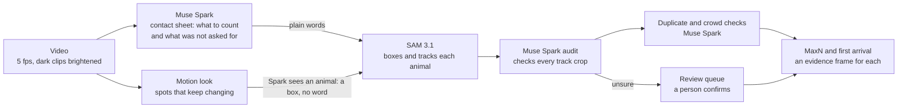

# reefcensus counts what you asked for & finds what you didn't

reefcensus counts animals in underwater survey video. Say what to count. You get MaxN for each animal (the most animals
of a kind on screen at once; the standard count of baited-camera surveys) and time of first arrival (when the first one
shows up) **with an evidence frame behind every number** (the frame where that count is seen with boxes drawn) & a
short queue of uncertain tracks for a person to confirm.
Built on Meta's SAM 3.1 and Muse Spark via the Meta Model API.

**Demo with no key or install:** https://kitavkdl.github.io/reefcensus/ (4 finished runs with their evidence frames and
count strip; answer the review queue in your browser).


**The problem.** Marine ecologists film the seafloor with baited cameras (BRUVs). Then a person watches every frame to
count what came: manual BRUV analysis "typically tak[es] several hours per hour of video" (Francour et al., 1999, as
cited by Marrable et al., 2022). On MBARI's deep-sea ROV dives where every animal is annotated, "these 90 hours of
video can take anywhere from 180 to 400 hours to annotate" ([MBARI expedition log, 3 March 2015](https://www.mbari.org/news/gulf-of-california-2015-leg-2-midwater-ecology-log-8/)).
reefcensus does that count with two Meta models: Muse Spark decides what to look for and checks every track & SAM 3.1
boxes and follows each animal through the video.

**What it found (measured; details in [report/details.md](report/details.md). Every claim with its evidence is in the table at the top of the [paper](report/paper/paper.md) & the PDF is [here](report/paper/paper.pdf)):**
- Asked for "fish" on a nautilus survey clip it also found and counted a nautilus, a swarm of shrimp and a hagfish
  (a jawless fish that SAM's "fish" did not find).
- At night behind a trap 17 fixed words (16 generic words plus "nautilus") box one nautilus for 9 of 60 frames. Spark
  points at what moved & SAM tracks four nautiluses from boxes with no word and sends a fainter fifth to the review
  queue (above; `report/scripts/split_s001_night.py` makes the video). The run's evidence frame is the first with four
  where three are still distant shapes; near the end of the clip all four are plain.
- On eleven videos from other studies (each run once under a protocol committed before the run) it named all five
  animals on the reference lists written beforehand; the current code gives the same scores.
- On 24 held-out seagrass videos of 1 to 12 s (never used while building; remote underwater video & not baited-camera
  footage) hand-counted separately by the author (not a marine biologist) and by a friend who had never seen the
  project's output, its summed MaxN error is 6 and 2 (exact on 18 and on 22 of 24). The human reference boxes (drawn to train a luderick detector &
  not to count MaxN) score 16 and 14 ([details](report/details.md#how-well-it-counts-measured)).
  Against the dataset's own boxes it is exact on 20 of 24. Of the 4 misses one clip is off by one & three are clips
  where the boxes missed fish (2→7, 1→5 and 2→4); a hand recount of those three gives 8, 3 and 5, so reefcensus is off
  by 2 in total & the boxes by 11. Two people counting by hand also agree exactly on only 20 of 24 (all within one fish).
- On a NOAA reef-fish set from the Gulf of Mexico hand-counted before the run, the four clips without fish come back 0
  with no false fish.
- In a crowd one SAM pass follows at most 16 animals, so Spark also counts the peak frame with no boxes. On both
  crowded test frames (crustaceans 4 against hand counts of 15 and 15; fish 16 against 44 and 45) it marks the MaxN
  "≥" for a person to count. It marks none of the 24 held-out seagrass peak frames. On the 53-minute deployment
  it marks the fish MaxN "≥ 14" (Spark counted 22 and 28 fish on two segment peak frames).
- On a 53-minute reef-fish deployment the review queue holds 1,082 uncertain tracks. Asking first only the ones that
  can still change a number settles every MaxN and first arrival after 24 to 84 answers (about 5 to 18 minutes on a phone
  estimated from the 13 s a track measured on 9 queued tracks) with exactly the numbers of answering all 1,082
  (checked with three simulated answer rules: accept all / reject all / follow the auditor).
- Reviewed counts download as a CSV & in GlobalArchive column order ([details](report/details.md#standard-maxn-export-globalarchive-layout)).

**What the scientist who filmed the nautilus footage said.** Gregory J. Barord is first author of the 2014 nautilus
survey whose videos S1 to S4 we used (Barord et al., *PLOS ONE* e100799). He wrote back the same afternoon he saw the results:

> Wow, this is so cool to see our nautilus BRUVS being used!!! I think that this would be an incredibly helpful tool
> for the BRUVS footage to identify nautiluses as well as the other species. Even if it cannot identify them to
> species, having something like this that could survey what is on the video and collate them, that would streamline
> the video analyses that we do.
>
> Gregory J. Barord, Ph.D., email of Nov 2, 2026

The two concerns he raised are what the tool is built around: low light (the night clip behind the trap above with
four nautiluses counted & a fifth queued for a person) and spot checks (every number opens its evidence frame & doubtful
tracks wait in a queue for a person). We are continuing after the hackathon with the guidance of the researchers we
contacted (Barord & Stony Brook University's Institute for Ocean Conservation Science): [Feedback and next steps](#feedback-and-next-steps).

Technical report with every measurement and what it changed in the design: [report/README.md](report/README.md).

**How it works: two Meta models through the Meta Model API (`muse-spark-1.3` and `sam-3.1`) as Spark → SAM → Spark.**



- **SAM 3.1** (Meta Model API) tracks generic categories ("fish" or "shark") through the video with no training.
- **Muse Spark** looks at a contact sheet (frames of the clip tiled into one image) and proposes what to track and
  where faint animals hide (zoom tiles). Then it audits every track crop (species / is-it-really-a-fish / confidence).
  Low-confidence tracks go to a human.
  Why Spark and not Meta's largest model: on the same 101 questions Muse Wonder named 12 things no reference list
  supports (4 of them not animals) against Spark's 5. It also rejected crops of animals a person was certain of & cost
  about 4.3× per call (paper Table 7).
- **Discovery** (`--discover`): SAM only sees what you name. Asked for "animal" it found nothing on 29 of the 39 clips
  we tested, including a seagrass clip where "fish" finds 10. So Spark looks for living things the request did *not*
  ask about (and indirect signs such as sediment puffs) & names each with plain nouns. SAM tries the words one at a
  time (the word ladder) until one tracks.
- **Motion look** (no word at all): pixels that keep changing in a still camera are "look here" hints. The spots Spark
  calls animals go to SAM 3.1 as a box with no word & a second Spark look must still see an animal before it counts.
- All API calls are cached by content hash and metered against a budget (`FISH_BUDGET`, default $1).

Each step in detail (closer look / duplicate boxes / motion look thresholds / mask decoder), long videos, the review
screen, the GlobalArchive export, `gapfind`, site memory and the full measured tables: [report/details.md](report/details.md).

## Try it

**No key needed to look:** the [demo](https://kitavkdl.github.io/reefcensus/) is the same review screen with no install.
Answering the queue recomputes the counts, ranges and CSV in your browser (kept until you reload; `demo/static_review.js`
is checked against the server by `tests/test_static_review.py`). Locally (Python 3.12+): `pip install -r requirements.txt && python3 web/server.py`
then open http://127.0.0.1:8793. Four finished nautilus runs (`demo/runs` copied into `runs/` on first start) play with
their evidence frames, motion sheets and human queue. No model is called. The web screen takes clips up to 2 minutes;
longer videos run from the command line (below).

**To run new clips with your own key:** `cp .env.example .env` and set `META_API_KEY` (or export it). `FISH_BUDGET`
is a hard cap on total spend in your local `cache/ledger.jsonl`; a fresh clone starts it empty ($0). The project's own
development spend is in `report/paper/data/ledger.jsonl`. In the held-out runs a 12 s clip cost about $0.02 to $0.40 (paper Tables 1f and 3b); a fresh discovery run on a development clip makes 21 to 30 calls for an estimated $0.22 to $0.27 (paper §6.4).

```
python3 fishcount/pipeline.py <video> [--prompts WORD ...] [--discover] [--zoom] [--offline] [--no-scout] [--no-audit] [--segment S]
                                         # what to count: --prompts words (default fish); quote two-word names
                                         # clean + refill are on by default (--no-clean --no-refill turns them off)
python3 fishcount/pipeline.py clip.mp4 --prompts fish shark "sea turtle" --discover   # also finds what you did not name
python3 fishcount/evaluate.py            # raw SAM 'fish': recall/precision/MaxN error vs. luderick ground truth
python3 fishcount/evaluate_pipeline.py --tag cr7   # the same next to the full pipeline (runs cr7_<clip>; later code cr8 to cr11 moved no score)
python3 web/server.py                    # review screen on http://127.0.0.1:8793
```

**Tests (no network / no key / $0):** `python3 -m unittest discover -s tests -v` runs 104 tests including an exact
offline replay of the s004 demo run and the long-video merge.

**Long videos** over 10 minutes are cut into segments of at most 600 s and merged into one ordinary run
([details](report/details.md#long-videos)).

**Fresh runs.** Spark's answers are not fixed, so a run with an empty cache can differ from the cached one. In four
empty-cache rehearsals DH11's amphipod was counted once and queued once & s003 counted 3 nautiluses in one take and 1
in the other (with the final word ladder that take's own answers count 3; paper *Failure modes of the VLM auditor*).

## Feedback and next steps

We sent the results to two groups who run baited cameras.

- **Gregory J. Barord** (first author of the nautilus survey whose footage we used; quoted above) answered on Nov 2,
  2026 and asked five questions that set the next steps:
  1. *Can it tell individual nautiluses apart and not only that something is a nautilus?* Within a clip yes: each
     animal is its own track & MaxN never counts one animal twice at the same moment. Across videos (the same
     animal recognised by its shell pattern) is the next thing to build.
  2. *What size clips does it work with?* Files up to 10 minutes are read at 5 frames per second. Longer recordings
     are split and merged & one 53-minute deployment has run end to end.
  3. *How does it curate the data?* Per species MaxN and time of first arrival each with its frame; a CSV & the
     GlobalArchive layout; a short review queue.
  4. *Will it be developed further?* Yes. We are continuing after the hackathon starting with his questions.
  5. *Why these videos?* Openly licensed & deep & dim & full of animals that are not fish: a hard test for a tool
     asked only for "fish".
- **Stony Brook University's Institute for Ocean Conservation Science** runs baited cameras in Shinnecock Bay with
  students reviewing the footage. We shared the tool with them on Nov 2, 2026.

**After the hackathon.** reefcensus continues with the guidance of the marine scientists who film and score this
kind of footage, starting with the two groups above (both already in contact). The next steps come from their
questions: recognising the same animal across videos (a nautilus by its shell pattern); running whole deployments
against counts made by their own annotators; replacing our non-expert reference lists with expert species lists so
that the names Spark proposes are checked by people who know the fauna.

## Data credits
- Ditria, E.M. et al. (2021) luderick-seagrass dataset (remote underwater video in seagrass; the source does not
  mention bait, so these clips are not counted as BRUV footage), CC BY 4.0 via PANGAEA doi:10.1594/PANGAEA.926930,
  github.com/globalwetlands/luderick-seagrass
- Barord, G.J. et al. (2014) Comparative population assessments of Nautilus sp., PLOS ONE 9(6): e100799,
  supplementary videos S1 to S4, CC BY 4.0 (via Wikimedia Commons)
- Held-out discovery clips (via Wikimedia Commons): Anderson, G.S. & Bell, L.S. (2014) PLOS ONE 9(10): e110710,
  videos S4, S1, S3, CC BY 4.0; Anderson & Bell (2016) PLOS ONE 11(3): e0149107, video S2, CC BY 4.0; Zintzen, V. et
  al. (2012) PLOS ONE 7(10): e48522, Video S1, CC BY 2.5 (URLs and hashes in `report/paper/data/discovery_heldout/clips.json`)
- Second held-out discovery clips (via Wikimedia Commons, PLOS ONE supplementary videos): Werry et al. (2014) Video S2
  (DH6), CC BY 4.0; Niemann et al. (2013) Video S1 (DH7), Oliver et al. (2011) Video S4 (DH8), Sturdivant, Diaz &
  Cutter (2012) Videos S4 and S1 (DH9, DH10), CC BY 2.5; Cuvelier et al. (2014) Video S4 (DH11), CC BY 4.0 (URLs in
  `report/paper/data/discovery_heldout2/clips.json`)
- 53-minute video: NOAA Fisheries, Southeast Fisheries Science Center, reef fish baited video, station T60233001,
  camera A (Open Data Dissemination bucket `nmfs_odp_sefsc`); US government work, public domain, attribution to the
  Southeast Fisheries Science Center (download script and hashes in `report/paper/data/long_video/`)
- NOAA held-out set (N1 to N8): the same NOAA bucket, eight stations chosen by rule (`report/paper/noaa_heldout_protocol.md`;
  stations, URLs and hashes in `report/paper/data/noaa_heldout/clips.json`); US government work, attribution as above

## Built during the hackathon
Built during the Meta AI hackathon (Oct 26 to Nov 4, 2026). The first API experiments ran on Nov 1 in a scratch folder
(kept in `spikes/`; its folders A to G are the early look at what SAM can do on sound / the sun / sea ice / sonar / thermal
video / AI-made video / a kitchen before the project settled on baited cameras). This repository starts on Nov 1
(first commit `85b825d`) & all code here was written in those days (third-party footage and libraries are credited
where used).

## License
MIT (code) except `fishcount/_maskdec.c`: a C port of `meta_sam_parser`'s mask codec under Meta's SAM License (copy
in `fishcount/LICENSE-SAM`). Videos and datasets keep their own licenses above.
