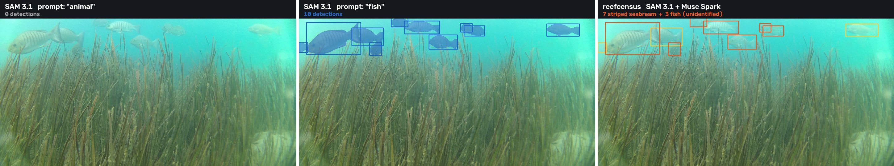
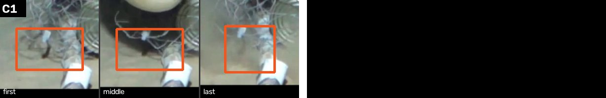

# reefcensus: counting what was asked for and finding what was not, with SAM 3.1 and Muse Spark

Technical report, Meta AI hackathon (Oct 26 – Nov 4, 2026). Every number below was measured on this code; the
command that produces it is under **Reproduce**. Where a number rests on a small sample, it says so.

## Summary
Baited underwater video (BRUV) is scored by hand: someone watches every hour and writes down, per species, the most
individuals seen in one frame (MaxN). reefcensus takes a request such as "fish" and returns per-species MaxN, the
time of first arrival, an evidence frame behind every number, and a short queue of tracks a person should confirm.

Two Meta models do different halves of the work. **SAM 3.1** tracks pixel masks through the clip, but only for what
it is told: asked for "animal" on the frame below it finds nothing. **Muse Spark** can look at frames and say what is there, but
gives no identities to follow from frame to frame. reefcensus puts them in a loop: Spark names what it sees (including animals nobody asked about), turns the
names into words SAM understands, and then checks SAM's work: every track, the frame that sets each MaxN, and whether
two overlapping masks are one animal. Where no word works, a still camera's own motion marks the spot, Spark decides
whether it is an animal, and SAM tracks it from a box with no word at all.

Results (details in **Evaluation**):
- **Counting, luderick (6 clips, 319 frames boxed by people):** recall 97.4% (the same as SAM alone: the checks throw away no real fish), precision 79.2% (a lower bound, see 4.1), MaxN within ±1 of the human count on all 6 clips and exact on 4 (SAM alone: 2); 9 of 27 tracks sent to a person. A rule with no model call, dropping tracks shorter than 4 frames, gives exactly the same numbers, so on this one-species task the checks match a well-chosen heuristic rather than beat it. The 97.4% counts the queued tracks as accepted; if a reviewer rejected all of them, recall would be 84.2%.
- **Held out (24 luderick clips never used in development, frozen code, one run, protocol committed first):** recall 98.9%, MaxN exact on 20 of 24 with the queue accepted (SAM alone and the length rule: 19); with the queue rejected every clip is within ±1 (recall 95.6%). The review screen shows MaxN as the range between those two cases until the queue is checked; it contains the human MaxN on 22 of 24 held-out clips (5 of 6 in development), a summary added after the run. Same estuary as the development clips.
- **Finding what was not asked for (4 nautilus clips, request "fish"):** Spark named all 7 non-fish taxa a person could see and all 7 reached the final count, with no label outside the person's list except two low-confidence "fish (unidentified)" tracks waiting in the queue (s002). SAM asked for "fish" alone found 0 of 7. Spark's naming plus SAM, with no checks, already finds 7 of 7 (with the motion look); the checks give the right names (hagfish, not SAM's "eel"), remove duplicate shrimp and a false "shrimp" on the trap net, and cost one nautilus in s001 (queued). The hardest one (nautiluses at night behind a wire trap) was found only by the motion look.
- **Finding what was not asked for, held out (5 new videos from other studies, frozen code, one run, protocol committed first):** Spark named all 4 non-fish animals the author and an AI assistant had marked before the run; 3 were counted and the 4th (a squat lobster that no word tracked, followed by a motion box in all 60 frames) was sent to a person to confirm. 0 false discoveries: every counted crop was judged an animal with its label hidden, and nothing non-fish was counted on the two clips without one. $1.06 for all five.
- **Cost:** a 12 s clip costs about $0.02 (counting only) to $0.40 (discovery; $0.22–0.27 on the development clips) in API calls; all answers are cached by content, so a rerun is free.


*Same seagrass frame (luderick archive 20190618_9, CC BY 4.0). Left: SAM 3.1 asked for "animal", 0 detections (none in
all 107 frames). Middle: asked for "fish", 10. Right: reefcensus, with Spark's names on SAM's tracks.*

## 1. Problem
A BRUV drops a camera next to a bait bag on the seabed. The standard abundance measure is MaxN: per species, the
largest number of individuals visible in any single frame, a conservative count that never double-counts an animal
that leaves and returns. Getting it means watching the footage. At MBARI, "these 90 hours of video can take anywhere
from 180 to 400 hours to annotate" (MBARI expedition log, Gulf of California 2015, Leg 2, Log 8, 3 March 2015).

Two things make automation hard. First, the species list is open: a survey aimed at fish also films shrimp,
nautiluses and hagfish, and those are often the interesting part. A detector trained on a fixed list cannot report
what is not on it. Second, a count is only useful if a scientist can check it, so every number needs evidence and
the doubtful cases need to be pointed out, not hidden.

## 2. Method
```
video ──► SAM 3.1 "fish" (whole frame, reversed clip, optional 2x2 zoom tiles)
   │
   ├─► Spark: "what else lives here?" ──► plain nouns ──► SAM word ladder ("hagfish" 0 → "eel" 24 frames)
   │         └─ nothing tracks → zoom tile, then the one cell Spark named at 3x, every word, longest wins
   │
   ├─► motion: pixels that keep changing outside every box (no model) ──► Spark, 3 crops per spot:
   │         animal or sediment? ──► animals → SAM box prompt, no word
   │         counted only if the audit is confident AND a second Spark look (other moments, no label) agrees
   │         (the same second look also gates a track the audit renamed to another discovered animal;
   │          if it names another animal group, the track still counts and goes to the queue)
   │
   ├─► merge + re-join broken track IDs
   ├─► Spark audit: 3 crops per track (early / middle / late) → species, is it the target, confidence
   │         confident "not the target" → removed; unsure → counted as "(unidentified)" and queued for a person
   │         (motion tracks: counted only if confident and the second look agrees)
   ├─► Spark "same animal?": one mask inside another → both outlines shown → duplicate removed
   ├─► Spark peak check: every box in the frame that sets MaxN, with the same track before and after
   │         (an answer naming another animal of the same group keeps the box and queues the track)
   └─► MaxN, first arrival, evidence frame per species; review screen; CSV
```
All Spark checks look at **three moments** of the same object at the same zoom. One crop of a sediment cloud can look
like a dark fish; across three crops the cloud spreads and changes shape while an animal keeps its shape. The same
three-crop view stopped the audit from discarding a faint fish behind seagrass (section 4.1).

## 3. What we measured about the models
These are the behaviours the design is built around. Each was found by trial during the hackathon.

| finding | evidence | what we did |
|---|---|---|
| SAM 3.1 mostly returns nothing for a broad word | "animal" on all 39 clips: nothing on 29; on the 30 luderick clips never more than 1 per frame where "fish" finds up to 10; it overlapped 3 of the 11 non-fish animals reefcensus counted | Spark proposes basic-level nouns (fish, shrimp, eel, nautilus) |
| SAM 3.1 returns nothing for the species' own name | "luderick" on the 6 luderick development clips: 0 on all six | species comes from the Spark audit, SAM gets the plain noun |
| A name SAM does not know can fail where a near word works | s004: "hagfish" 0 frames, "eel" 24 frames | word ladder, Spark's own name kept for the label |
| Word tracking starts only once the object is clear and runs forward | animals clear only late in a clip were missed before that point | the clip is also run reversed and the two are joined |
| A **box prompt with no word** tracks both ways from its frame | s004 bottom-edge shrimp: no word, tile or reversed pass ever tracked it; one box → 57 of 60 frames in the first test, 55 of 60 in the pipeline | motion look → Spark → box prompt |
| A box touching the frame edge is rejected | `y2 = 1080` on a 1080-high clip: HTTP 400 "lies outside the frame" | boxes clamped to H−2 |
| Spark sometimes breaks JSON when asked for JSON only | twice during development (for example `{ polo":1 }:`); bad replies are no longer stored, so the rate is not known | a reply that fails its shape check is not cached and is asked once more |
| Spark's judgement depends on where the judged frame sits | same faint fish, same three crops (luderick 20190618_9, frame 35): with the judged frame at the strip's edge Spark answered "seagrass" in 11 of 25 calls, with it in the middle 0 of 25 (Fisher p = 0.0002) | the judged frame always sits in the middle (`report/paper/scripts/repeat_peak_score.py`) |
| Spark's judgement depends on what else is on the sheet | the same pair of masks (s004, frame 27) was "same animal" on one sheet and "different" on another | decisions that set a count are made on small sheets with three crops; doubtful ones go to a person |
| The audit takes up a name it is offered | s003: a motion box that had drifted onto the trap's net legs was audited as "large striped shrimp", 0.75 — a name the discovery step had guessed (wrongly) and the audit prompt listed as context. Shown other moments with no label and no names, Spark said "trap mesh, not animal" | a motion track counts only after that second, unprimed look agrees |
| Spark answers from the words it is offered | s001: the motion prompt's example nouns left out nautilus, so a spot Spark described as "striped nautilus shell" got the name "snail" | a name the discovery step already gave wins when Spark's own description uses it |

## 4. Evaluation
### 4.1 Counting against human boxes (luderick)
Six luderick clips with human bounding boxes (Ditria et al. 2021), 319 annotated frames, a match at IoU ≥ 0.3. MaxN
is taken over the annotated frames only, for both columns.

| clip | annotated frames | SAM "fish" alone: recall / precision / MaxN true→counted | reefcensus: recall / precision / MaxN true→counted | tracks sent to a person |
|---|---|---|---|---|
| 20190618_9 | 44 | 98% / 72% / 9→10 | 98% / 72% / 9→10 | 4 of 14 |
| 20190709_14 | 126 | 100% / 72% / 2→2 | 100% / 72% / 2→2 | 1 of 3 |
| 20190618_3 | 58 | 100% / 98% / 2→3 | 100% / 100% / 2→2 | 1 of 3 |
| 20190710_4 | 40 | 82% / 100% / 2→1 | 82% / 100% / 2→1 | 0 of 1 |
| 20190709_13 | 40 | 100% / 100% / 2→2 | 100% / 100% / 2→2 | 0 of 3 |
| 20190709_4 | 11 | 100% / 71% / 2→3 | 100% / 77% / 2→2 | 3 of 3 |
| **all** | **319** | **97.4% / 78.7%**, MaxN off by 1 on 4 of 6 | **97.4% / 79.2%**, MaxN off by 1 on 2 of 6 | **9 of 27** |

- **The checks fix SAM's over-counts without losing fish.** On 20190618_3 and 20190709_4, SAM alone counts 3 where
  people counted 2; the audit brings both to 2 by rejecting a 2- and a 3-frame track. Recall stays at SAM's 97.4%.
  Dropping every track shorter than 4 frames does exactly the same (3 frames fixes one clip, 5 or more lose fish), so
  the checks' value on this task is matching the best threshold without tuning one (see the paper, Table 1).
- **They did lose fish at first.** With one crop per track (its largest box), the audit called a faint fish behind
  seagrass "only seagrass and water" and a 36-frame track left the count; the peak check did the same to another
  faint fish in frame 35 of 20190618_9. Recall fell to 95.9%. Three crops of the same track (early / middle / late,
  and for the peak check the same track just before and after) brought it back to 97.4%.
- **Layout matters, not only content.** A later version moved "this frame" to the first crop when a track starts in
  that frame (so no crop repeats). The same faint fish in frame 35, whose track starts there, was again called
  "seagrass, no fish" and recall dropped to 96.3%. Keeping the judged frame in the middle and repeating it restored
  97.4%. Every prompt or sheet change is now rerun against this clip and against nautilus clip s004's peak frame.
- **The two MaxN misses left.** 20190618_9 (9→10): in the frame that sets the count, two real fish (one cut by the
  left edge) have no human box. 20190710_4 (2→1): a dark fish in murky seagrass that SAM never finds, so no check
  can add it.
- **Precision is a lower bound.** Of 12 tracks scored as false positives in an earlier run, 6 were checked by eye and
  all 6 were real luderick the annotators had not boxed.

### 4.2 Finding what was not asked for (nautilus)
Four nautilus BRUV clips (Barord et al. 2014), 12 s each, request = "fish" only. Before looking at any pipeline
output, every non-fish animal in four frames per clip (frames 0, 20, 40, 59) was listed by eye at taxon level. This is
a non-expert list: 7 taxa over the four clips.

| clip | animals a person listed (not fish) | reefcensus final count (MaxN) | how it was found |
|---|---|---|---|
| s001 (night, wire trap) | nautilus: 1 inside the trap, 3+ outside | **nautilus 4**, none queued (final code) | the clip is dark (brightness median 5, mean 26.5), so the final code brightens it first (gamma 0.5 + CLAHE; thresholds set from our development clips, post hoc, see `paper/lowlight_s001.md`). Then "shell" follows one nautilus for 9 frames and the motion look → Spark "nautilus" → four SAM box prompts (50–60 of 60 frames), all four pass the audit and the second look, peak check keeps 4 of 4. Before brightening (v16): no word, zoom or 3x cell tracked anything, 2 counted and a third (audit 0.55) queued |
| s002 | nautilus 1; red crustaceans 2 (by the rope, by the bait) | nautilus 1; **small red crab 1** | Spark: "small red crab on seabed". The word "shrimp" tracked it in a 3x cell; the audit said "small red crab, not shrimp" (0.7), which matches the discovery name, so the track is relabelled; the unprimed second look agrees ("small red crab with legs shifts"). The crustacean at the bait is held as "fish (unidentified)" for a person |
| s003 | nautilus 3–4 | nautilus 3 | word "nautilus" + zoom tiles. Spark also proposed a "large striped shrimp" that is not there: no word tracked it, and the motion box later audited under that name was rejected by the second look (figure below) |
| s004 | nautilus 1; shrimp 10+; one grey eel-like animal (hagfish) | nautilus 1; caridean shrimp 12 (+3 unidentified; 15 together in frame 54); hagfish 1 | "hagfish" 0 frames → "eel" 24 frames, labelled hagfish. Two shrimp at the bottom edge only through motion boxes (tracked in 55 and 30 frames) |

| measure | result |
|---|---|
| Spark names it | 7 of 7 taxa |
| reaches the final count | **7 of 7** taxa |
| false animal counted | **0** |
| SAM "fish" alone | 0 of 7 (in s002 it boxed the two crustaceans as low-confidence "fish") |

Counts of individuals cannot be scored here: four frames per clip are not enough for a person to count 10+ shrimp.
In s001, v16 counted 2 of the 4+ a person sees; the final code, which brightens this night clip, counts 4.


*Motion look, s004: each group is one moving spot that no box covered, shown early / middle / late. Spark calls the
shrimp animals and the sediment puffs not; the shrimp then go to SAM as box prompts.*



*s003. Top, right group (T6): a motion box that drifted onto the trap's net legs; the audit, whose prompt listed the
discovery step's guess "large striped shrimp", passed it at 0.75. Bottom: the same track at other moments, no label,
no names: "looks like trap mesh, not animal". It is not counted.*

### 4.3 Finding what was not asked for, on five new videos (held out)
Five clips from other studies, never used in development: three deep carcass cameras at 95 m in Saanich Inlet, British
Columbia (DH1–DH3, Anderson & Bell 2014), a pig carcass in the Salish Sea (DH4, Anderson & Bell 2016) and a fish-only
New Zealand BRUV (DH5, Zintzen et al. 2012). The selection rule, metrics and command were committed before any run
(`report/paper/discovery_heldout_protocol.md`); the code was frozen and each clip run once. Before the run the author and, separately, an AI
assistant (Claude) marked and at a coarse group level, the non-fish animals they could see in four frames per clip.

| clip | marked by both (not fish) | Spark named | counted (MaxN) | to a person |
|---|---|---|---|--:|
| DH1 | crab-like | crab | **crab 1** | 1 |
| DH2 | crab-like (+ an anemone-like animal) | sea anemone, crab, eel | **crab 1**, sea anemone 1 | 5 |
| DH3 | crab-like; shrimp/lobster-like | spider crab, squat lobster shrimp, sunflower sea star | **spider crab 3**; the squat lobster, which no word tracked, was followed by a motion box in 60 of 60 frames and sent to a person (audit 0.5) | 6 |
| DH4 | none | — | nothing | 0 |
| DH5 | none (fish only) | small shrimp | no non-fish animal | 14 |

| measure | result |
|---|---|
| Spark names it | **4 of 4** |
| counted | **3 of 4**, the 4th waiting for a person |
| false discoveries | **0** (every counted crop judged an animal by a person who did not see the label) |
| cost | $1.06 for all five |

Rows, evidence crops, both reference lists and the judgement: `report/paper/data/discovery_heldout/`
(`python3 report/paper/scripts/score_discovery_heldout.py`).

## 5. Reading the numbers
- **Scope.** Counting: 30 luderick clips from one estuary (6 development, 24 held-out). Discovery: 9 clips of 12 s
  from four studies (4 development, 5 held-out). Counts are what a reviewer confirms from the queue and the evidence
  frames; species names are Spark's proposals.
- **Precision is a lower bound.** Six of twelve "false-positive" luderick tracks were checked by eye and all six were
  real fish the annotators left unboxed.
- **Spark's confidence means something.** Over 74 judged luderick tracks, the share that match a human box rises from
  0 of 7 (confidence below 0.5) to 45%, 77% and 96% (0.9 and above), so the 0.7 threshold sends the mixed band to a
  person (`report/paper/scripts/calibration.py`).

## 6. Reproduce
```
pip install -r requirements.txt
export META_API_KEY=...            # or .env; not needed for cached replays
export FISH_BUDGET=1.0             # hard cap on total spend (USD)
# FISH_LEDGER=<path>               # optional: another spend ledger (e.g. the main checkout's, from a git worktree)
python3 fishcount/evaluate.py                          # SAM "fish" alone vs. luderick boxes
python3 fishcount/evaluate_pipeline.py --run --tag t1  # full pipeline vs. the same boxes (runs t1_<clip>)
python3 fishcount/pipeline.py <clip> --no-scout --prompts fish --discover --zoom   # discovery run
python3 report/paper/scripts/score_discovery_heldout.py   # held-out discovery table (no API, no video needed)
python3 web/server.py                                  # review screen, http://127.0.0.1:8793
```

## Data
- Ditria, E.M. et al. (2021) luderick-seagrass dataset, CC BY 4.0, PANGAEA doi:10.1594/PANGAEA.926930
- Barord, G.J. et al. (2014) Comparative population assessments of Nautilus sp., PLOS ONE 9(6): e100799, S1–S4, CC BY 4.0
- Held-out discovery clips (Wikimedia Commons copies): Anderson & Bell (2014) PLOS ONE 9(10): e110710, S4/S1/S3,
  CC BY 4.0; Anderson & Bell (2016) PLOS ONE 11(3): e0149107, S2, CC BY 4.0; Zintzen et al. (2012) PLOS ONE 7(10):
  e48522, Video S1, CC BY 2.5
