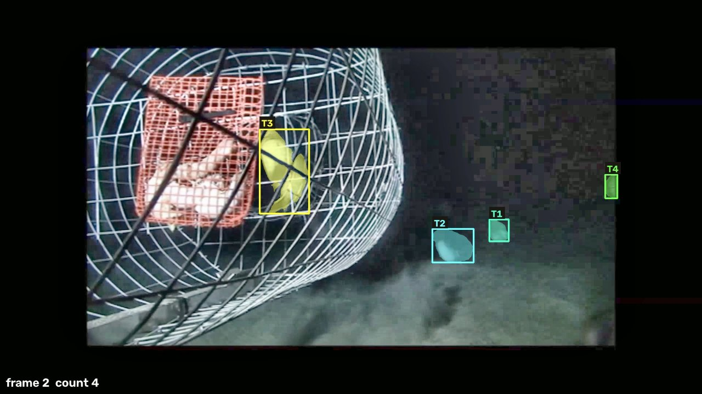

# Post-hoc low-light test on s001 (night, wire trap)

**Post-hoc, on a development clip.** s001 (Barord et al. 2014, S1, 0–12 s) is the clip where the submitted pipeline
counted 2 nautiluses while a person sees 1 inside the trap and 3+ outside (report/README.md, discovery table). This test
asks one question: does simply brightening the video before the unchanged pipeline recover the missing animals?
The pipeline code was not changed; the brightened copies are inputs. Nothing here was used to tune the held-out runs.

## Method
`report/paper/scripts/lowlight_s001.py` (parameters fixed in the script before any run):

| variant | filter |
|---|---|
| gamma | per-channel gamma 0.5 |
| clahe | CLAHE on Lab L channel, clipLimit 3.0, 8×8 tiles |
| gamma_clahe | gamma 0.5, then CLAHE clipLimit 2.0, 8×8 tiles |

Each copy: same 60 frames (5 fps, 1920×1080), H.264 crf 18. Run with the demo options of `L1_s001_v16`
(`--no-scout --prompts fish --discover --zoom`, per-video cap $0.40), one live run each, uncached (new inputs).

## Results

| run | words that tracked anything | counted (MaxN) | to the person queue | counted wrongly | live calls | cost |
|---|---|---|---|---|---|---|
| v16, original (submitted) | none | **2** (both outside, motion boxes) | 1 | 0 | — | — |
| gamma | none | **3** (2 outside + the one inside the trap) | 1 (a real nautilus, audit 0.65) | 0 | 19 | $0.194 |
| clahe | none | **3** (all outside) | 1 (the one inside the trap: audit 0.9, but the unprimed second look said "trap mesh only") | 0 | 23 | $0.200 |
| gamma_clahe | "shell", 9 frames (first word ever to track anything on s001) | **4** (1 inside + 3 outside, peak frame 2, all 4 boxes kept by the peak check) | 0 | 0 | 19 | $0.184 |

- The same four animals appear in all three brightened runs (matching box positions: one behind the mesh at about
  x 700–930, y 240–520, and three on the seabed right of the trap). With the queue accepted, gamma and clahe also reach 4.
- Reference: 1 inside + 3+ outside, i.e. 4 or more. No run counts above 4, so no overcount is visible; whether
  there is a fifth animal cannot be settled from this clip.
- All runs still depend on the motion look: the words "nautilus" and "snail" never tracked anything, even brightened.
- Total cost of this test $0.578 (ledger, 61 calls).

*gamma_clahe, frame 2: count 4 (T3 behind the trap mesh, T1, T2, T4 on the seabed).*

## Limits
- One clip, development data, three variants tried after the fact; picking the best of three is a selection. The
  honest summary is "every variant improved 2 → 3 counted (4 with the queue accepted); the strongest reached 4".
- Not tested on normally lit clips: brightening might add noise or false motion there. **Update (11/2):** after this
  test the final code brightens automatically, only clips darker than a threshold (Lab L median < 15 and mean < 35),
  with the strongest variant (gamma 0.5 + CLAHE 2.0). The threshold was set from the development clips' brightness
  (s001 5/26.5 is brightened; the next darkest, s004 at 26/42, is not), so it is a post-hoc rule; none of the held-out
  clips (DH1–DH11, 24 luderick) is that dark, so the held-out runs do not test it. On the frozen code s001 counts 4,
  none queued.

## Draft sentence for the paper (post-hoc)
> In a post-hoc test on the development night clip s001, brightening the video before the unchanged pipeline
> (gamma 0.5, CLAHE, or both; parameters fixed before running) raised the count from 2 to 3 in every variant, and to 4
> (the number a person sees: one inside the trap and three outside) with gamma plus CLAHE, with no animal counted
> wrongly ($0.58 for the three runs). This is one development clip and not part of the evaluated system.
