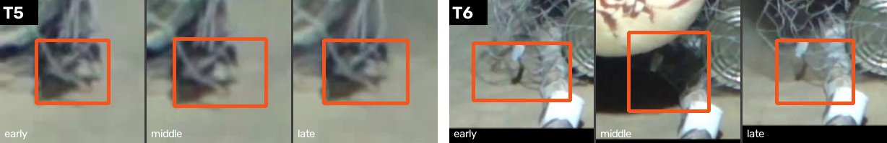
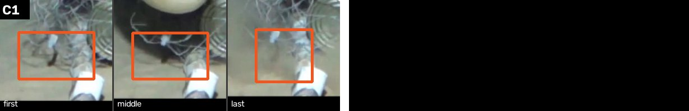

<div class="abstract">

**Abstract.** Baited underwater video surveys report abundance as MaxN, the largest number of individuals of a
species visible in one frame. SAM 3.1, a promptable segmenter, tracks whatever short noun it is given, and only that:
on our 39 clips "animal" returned no box on 29, and the name "luderick" returned nothing on all six clips of that
species. Without training, we put a vision-language model (VLM), Muse Spark, in front of it. The VLM names animals
the request left out, in nouns the segmenter answers; where no word works, it picks moving spots that keep their
shape, and the segmenter tracks each from a box with no word. The VLM then audits every track, and doubtful ones go
to a person instead of the count. Discovery is scored as presence of taxa. On four development nautilus clips the
pipeline finds all seven taxa a person listed; on a night clip where 17 fixed words box one nautilus, it
counts four and sends a fainter fifth to a person. On five held-out videos it names all four non-fish animals marked beforehand, counts three, queues
the fourth and counts nothing that is not an animal; on six more it counts the one animal two people marked beforehand. For the
request "fish" (a group count; luderick and bream are scored together), on 24 held-out clips, the pipeline's MaxN is closer to a hand count of the videos than
the reference boxes are, under each of two independent counters (summed error 6 against 16 for the first author, 21 of 24 counted blind; 2 against 14 for a second person who never saw the project's output; within one fish on all 24), and none of 40 randomly drawn boxes
scored as false positives was judged not a fish: corrected precision is 93.7% (95% interval 89.6–97.0%, resampling tracks), against 77.2% on the boxes. The
audits are built around how a VLM fails: every object is judged at three moments, and the second look of a weakly
supported track sees no label and no earlier names. Doubtful tracks are asked in the order that settles the counts: on a
53-min deployment, 20–54 answers instead of a queue of 1,048. The result is an annotation accelerator whose output a
person confirms. Marine scientists have already been contacted, and development continues with them after the
hackathon.

</div>

**Claims and evidence.** n = clips.

| claim | evidence | n | scope |
|---|---|--:|---|
| SAM 3.1 answers narrow words: "animal" gives no box on 29 of 39 clips; "luderick" gives nothing on all six clips of that species | §7.4, Table 6 | 39; 6 | our clips |
| On luderick the audits keep the segmenter's box recall (97.4% development, 98.9% held-out) and reach the MaxN of a tuned minimum-track-length rule | §6.1 Table 1; §6.2 Table 1c | 6 development; 24 held-out | one estuary; request "fish", luderick and bream scored as one group, not per species |
| Against a hand count of all 24 held-out videos the pipeline's MaxN is exact on 18, within ±1 on 24, summed error 6; the reference boxes 16, 22 and 16 | §6.2 Table 1d | 24 held-out | counted by the first author, 21 of 24 blind and shuffled; the same with the queue answered from recorded human judgements instead of accepted |
| Against a second, independent hand count (a person who never saw the project's output) the pipeline is exact on 22, within ±1 on 24, summed error 2; the reference boxes 18, 21 and 14 | §6.2 Table 1e | 24 held-out | blind, shuffled, key fixed before counting; the two counters agree within one fish on all 24 (exact on 20) |
| On eight NOAA Gulf of Mexico survey clips cut by rule, the four without fish are counted 0 with no false fish (two of them first hand-counted as 2 and 4); the clip of nine faint far fish is flagged as a lower bound once the frame is tiled | §6.2 Table 1f | 8 held-out (another ocean) | one hand count; exact 5 of 8, summed error 14, the errors on small faint fish over a hazy floor; the tiled run was chosen after seeing |
| One person fixes the held-out reference in 9 min 39 s: 20 tracks judged on a phone, 15 unboxed fish (145 boxes) added, 0 not a fish; the corrected MaxN matches the hand count as closely as the pipeline (Σ\|err\| 6 vs 16) | §6.2 | 24 held-out; 20 tracks + 3 controls | the pipeline is not re-scored against boxes it added; re-judged, 11 of 11 earlier "fish" tracks were fish again |
| Most held-out "false positives" are unboxed fish: of 40 drawn at random, 29 fish, 2 part of a fish, 9 unsure, 0 not a fish (precision 93.7%, 95% interval 89.6–97.0% by track, vs 77.2% scored) | §6.2 | 40 boxes; 10 controls | labels hidden; 10/10 matched controls called fish |
| The person queue (17 of 50 tracks) holds most of the tracks behind the largest over-counts | §6.1 Table 1b; §6.2 | 24 held-out | |
| Clearing the queue is quick: 9 queued tracks of four clips took one person 121 s on a phone; all 6 accepted tracks overlap the human boxes, the 3 left unsure match none | §6.1 | 4 development; 9 tracks | |
| A person need not clear the whole queue: asking first only the tracks that can still change a count settles every MaxN and first arrival of a 53-min video after 20–54 answers instead of 1,048, with exactly the numbers of answering everything | §4.7, §6.4 | 46 runs | stand-in answer rules (accept all, reject all, follow the auditor), not a person's answers |
| Blind against a person, the auditor's accepts hold (19 of 20 at confidence ≥ 0.7, 11 of 14 below) and rejections are the part to ask a person about (the person was sure 8 of 13 answered rejected cards were the animal), which is how the queue is built; pool-weighted agreement 82.5%, and 6 of 9 unconfident rejections, which are counted anyway, were surely the animal | §7.9 | 60 tracks, 3 strata, asked twice | |
| On nautilus clips VLM naming finds six of seven taxa without any audit (seven with a motion cue); audits fix names, duplicates and one false taxon | §6.3, Tables 2–3 | 4 development; 7 taxa | taxa scored as present; reference list from four frames |
| On five held-out videos the pipeline names 4 of 4 non-fish animals marked beforehand, counts 3, queues 1, counts no non-animal | §6.3, Table 3b | 5; 4 animals | clips selected for non-fish animals; presence only; marked from four frames per clip |
| On six more held-out videos it counts the one animal marked beforehand and no non-animal | §6.3, Table 3c | 6; 1 animal | marked from four frames per clip; four of the six selected for a named non-fish animal; the fixed 16-word baseline finds the same animals |
| Counts of animals found without being asked match two counters' counts of the peak frame in sparse scenes (exact on 8 of the 12 frames with at most four animals), and the crowd check marks two of the three crowded frames "≥" (4 vs. 15 crustaceans, 16 vs. 44 fish); no mark on 24 held-out luderick peak frames | §4.7, §6.3, Table 3e | 17 + 24 frames | two counters |
| The audit design follows measured VLM behaviour: with the judged frame at the strip's edge a faint fish is missed in 11 of 25 calls, in the middle in 0 of 25; a second look with no label and no earlier names removes the false taxon an anchored audit passed | §7.1, §7.5 | 25 calls per layout; 6 development | |
| Muse Wonder, Meta's larger VLM, given Spark's 101 questions, rejects tiles of a crab a person was certain of, gives 12 unsupported names against Spark's 5, and costs about 4.3× per call | §7.6, Table 7 | 15; 101 questions | same questions, not Wonder's own run |
| A plain propose–segment–look–revise loop (the SAM 3 Agent pattern) with the same models reaches 3 of 5 held-out marked animals and 5 of 7 development taxa, against 4 of 5 and 7 of 7 | §7.7, Table 8 | 15 | text prompts, full frame, forward only |
| An open-vocabulary detector (OWLv2) given "animal" and the same 16 words overlaps 39 of the 45 counted non-fish tracks, but none through "animal", 17 only as "fish" and 11 with a word of the right group, and adds 1,716 unmatched non-fish boxes | §7.8, Table 9 | 15 | base-size detector, no tracking; measures agreement with the pipeline's counted tracks |


# Introduction

A baited remote underwater video system (BRUV) is a camera lowered next to a bait bag; it records for an hour or
more while animals arrive, feed and leave. The standard abundance metric extracted from such footage is MaxN: for
each species, the largest number of individuals visible in one frame (Priede et al., 1994; see Langlois et al.,
2020). MaxN is conservative by construction, since an animal that leaves and returns can never be counted twice,
and it is an index of relative abundance, comparable between deployments filmed the same way, not a density or a
population size; every count in this paper is meant in that sense. It is "the most commonly reported metric" for BRUVs (Whitmarsh et al., 2017, as cited by Connolly et al., 2021).
It is also expensive. BRUV analysis "typically tak[es] several hours per hour of video" (Francour et al., 1999, as
cited by Marrable et al., 2022),
and field guides ask annotators to identify "all fish ... to the lowest taxonomic level possible" (Langlois et al.,
2020, §2.6.3), then have a senior analyst re-check 10% of videos against a 95% accuracy bar (§2.6.7).

Automated counting for BRUV has made real progress, but almost always for a fixed list. Detectors have been trained
for luderick (Ditria et al., 2020a), Australasian snapper (Connolly et al., 2021), yellowfin bream
(Lopez-Marcano et al., 2021), elasmobranchs (Varini et al., 2024) and up to twelve target species plus a catch-all
"fish" class (Marrable et al., 2022). Single-habitat detectors transfer poorly to other habitats (Ditria et al.,
2020b). Two properties of the manual task are therefore hard to reach. First, the species list is open: a nautilus
survey also films hagfish and shrimp, as the supplementary video captions of Barord et al. (2014) note, and those
animals are often the interesting part. A detector trained on one taxon has no way to report them. Second, a count
is only useful if a scientist can check it. Every number needs an evidence frame, and doubtful cases need to be
surfaced rather than silently resolved.

Promptable foundation models change what an off-the-shelf system can attempt. SAM 3 performs promptable concept
segmentation in video, returning masks and identities "for all matching object instances" of a short noun phrase
(Carion et al., 2026); SAM 3.1 adds faster multi-object tracking (Meta, 2026). A general VLM can describe a frame in
open vocabulary. Neither alone does the BRUV task. The segmenter tracks only what it is told to look for, and we show
that the words it responds to are narrow. On still frames the VLM names animals, but it returns no identities to follow through a clip, and as a judge
it is subject to the anchoring, sycophancy and order effects documented for language and vision-language models
(Jones and Steinhardt, 2022; Dang et al., 2024; Tian et al., 2025).

This paper is an analysis of combining the two for abundance counting when the species list is not fixed in advance, organised around measured failure
modes rather than around a model. Our contributions are:

1. **Measurements of what a promptable video segmenter responds to on BRUV footage.** On 29 of our 39 clips SAM 3.1
   returned nothing for the hypernym "animal", and on all six luderick development clips nothing for "luderick";
   a rare name failed where a basic-level neighbour worked ("hagfish" vs. "eel"); word-prompted tracks began only
   once an animal was clear (a reversed pass recovered 16 → 60 frames for one nautilus); and a box prompt with no
   word tracked an animal that no word or zoom ever found (§7.4).
2. **A pipeline that uses the VLM as namer, translator and auditor of the segmenter,** with three audits aimed at the
   ways a MaxN goes wrong (a false track, a duplicated animal in the peak frame, a wrong box in the peak frame), a
   motion-residual path for animals no noun reaches, and a second unprimed look for tracks that rest on weak
   evidence (§4).
3. **An evaluation on two tasks** (counting against human boxes, discovery of untargeted taxa) **against model-free
   and no-audit baselines, with a design ablation** that shows recall and MaxN accuracy moving with the layout of the
   evidence sheet, including a variant that scores better on MaxN for the wrong reason, and repeated calls that
   separate the layout effect from nondeterminism (§6, §7.1). On single-category counting the audits match a track-length rule; on discovery the naming step finds
   the taxa and the audits fix names, duplicates and false taxa.
4. **A catalogue of VLM-auditor failure modes observed in a counting pipeline**, each tied to the count it changed:
   name anchoring, vocabulary priming, layout and context sensitivity, nondeterminism, wrong rejections in the peak
   check, malformed output, and species names that are only proposals (§7.5).

We position the auditing loop as an application of a known pattern rather than a new agent: SAM 3's own data engine
uses MLLMs as "AI verifiers" of masks, and its "SAM 3 Agent" lets an MLLM propose noun phrases and check the returned
masks (Carion et al., 2026, §4 and §6). What is new here is the target (ecological counts with per-number evidence),
the specific checks that a MaxN requires, and measurements of how those checks fail.

The work continues after the hackathon with marine scientists, starting with two groups already contacted: the first
author of the nautilus survey and Stony Brook University's Institute for Ocean Conservation Science (§9).

{.wide}

# Related work

**MaxN and BRUV annotation.** MaxN, also defined as MAXNO for baited video by Ellis and DeMartini (1995), is the
field's standard abundance index (Langlois et al., 2020). It is known to be a non-linear, saturating function of true
abundance (Schobernd et al., 2014) and to depend on non-density factors such as swimming speed and bait plume
(Kilfoil et al., 2021); Ellis and DeMartini (1995) already noted earlier deep-sea work in which MAXNO was unrelated or
inversely related to density. We do not take a position on MaxN as an index; we take it as the quantity annotators
are asked to produce, and note that because it is a single-frame maximum it inherits any duplicate or spurious
detection in that one frame (Connolly et al., 2021, report raw detector counts off by up to 50% at high density).
Shortcuts already used to cut effort have costs: subsampling 40 frames per hour kept MeanCount accurate but
underestimated species richness by about 40%, "missing the less common species" (Hsu et al., 2025).

**Automated fish detection and counting.** Closed-set detectors with tracking or sequence suppression are the norm
(Ditria et al., 2020a; Lopez-Marcano et al., 2021; Connolly et al., 2021; Varini et al., 2024). Marrable et al.
(2022) is the broadest BRUV system we found, and still reports that "88% of fish were located and given a fish label
and identified for manual labelling". Motion has been used to generate fish candidate regions for training a
detector (Salman et al., 2020) and background modelling with a false-positive filter is a classic approach for fixed
underwater cameras (Giordano et al., 2016). Datasets such as DeepFish (Saleh et al., 2020), FishNet (Khan et al.,
2023) and the luderick seagrass set (Ditria et al., 2021) support this line. Marine segmentation foundation models
are typically fine-tuned: CoralSCOP for coral stills (Zheng et al., 2024b), Dual-SAM for single-image marine animals
(Zhang et al., 2024), SAM-U for underwater video after a reported 13-point J&F drop of open-air models (Zhao et al.,
2026). SAM-family models have been used on BRUV footage in a training-free pipeline (Kavasidis et al., 2025) and as an
annotation aid (Sánchez et al., 2026). To our knowledge no prior BRUV work names and counts untargeted taxa without a
species list, or uses a VLM to audit a tracker's output at the MaxN frame.

**Open-set recognition in the ocean.** FathomNet aggregates expert-labelled ocean imagery for 2,244 concepts (Katija
et al., 2022), and its 2023 competition frames recognising "a new organism, an unusual collection of animals, or ...
out-of-sample" data as central (Orenstein et al., 2023). These works evaluate identification on images; they do not
connect open-vocabulary naming to an abundance metric and its evidence frame.

**Promptable and open-vocabulary segmentation.** SAM (Kirillov et al., 2023) and SAM 2 (Ravi et al., 2025) made
segmentation promptable by points and boxes; SAM 2 notes failures "in crowded scenes, after long occlusions or in
extended videos". SAM 3 adds concept prompts, constrained to "simple noun phrases" for "atomic visual concepts", and
lists weak zero-shot generalisation "to fine-grained out-of-domain concepts" as a limitation (Carion et al., 2026).
Open-vocabulary detectors (Liu et al., 2024; Minderer et al., 2022, 2023; Cheng et al., 2024) show the same pattern
on benchmarks: OVDEval reports that top models "all fail on the new tasks except for simple object types" (Yao et
al., 2024), detection depends on which synonym names an object (Nebbia and Kovashka, 2024) and on the choice of
class names (Parisot et al., 2023). VLMs themselves prefer basic-level categories in the sense of Rosch et al.
(1976) (Sawyer et al., 2025, for two open VLMs other than the one used here), which suggests that a VLM can act as
the translator between a scientist's request and the segmenter's vocabulary. Underwater, SAM 2's quality is "extremely dependent on the type of user-provided prompts",
with ground-truth boxes working far better than automatic point prompts (Lian and Li, 2024).

**VLMs as verifiers, and how they fail.** LLMs and MLLMs are used as judges and critics (Zheng et al., 2023; Chen et
al., 2024; Xiong et al., 2025), as tool users that call vision models (Gupta and Kembhavi, 2023; Surís et al., 2023)
and as reasoning segmenters (Lai et al., 2024). Marks drawn on an image steer a VLM's attention (Yang et al., 2023;
Shtedritski et al., 2023), and cropping helps with small subjects (Zhang et al., 2025). Their failure modes are well
documented: object hallucination (Rohrbach et al., 2018; Li et al., 2023), sycophancy (Sharma et al., 2024; Li et
al., 2025), flips after a single misleading cue in 65% of cases (Dang et al., 2024), anchoring that is not fixed by
telling the model to ignore the anchor (Lou and Sun, 2024), sensitivity to option order (Pezeshkpour and Hruschka,
2024; Zheng et al., 2024a) and to image position in multi-image inputs (Tian et al., 2025), and run-to-run
nondeterminism even at temperature zero (Atil et al., 2024; He, 2025). Self-correction without external feedback is
unreliable (Huang et al., 2024); answering verification questions independently, so that "answers are not biased by
other responses", reduces hallucination (Dhuliawala et al., 2023). Our second unprimed look follows that idea.

**Humans in the loop.** Camera-trap work combines models with people: automation is gated by confidence with the
rest sent to people (Norouzzadeh et al., 2018; Beery et al., 2019), models trained on citizen-science labels reduce
human effort on new studies (Willi et al., 2019), and accuracy drops on faunas new to a model (Tabak et al., 2019).
Marine annotation platforms such as BIIGLE (Langenkämper et al., 2017), MAIA (Zurowietz et al., 2018), CoralNet
(Beijbom et al., 2015) and Squidle+ (Friedman et al., 2026) keep a person in charge with machine suggestions and
"Needs Review" flags. Verification instead of drawing is a long-standing way to cut annotation cost (Papadopoulos et
al., 2016). We follow this norm: the pipeline's output is a set of counts plus a queue of tracks that a person
should confirm.

# Problem setting

**Input.** A clip $V = (I_1, \dots, I_T)$ from a fixed camera, re-encoded to 5 frames per second, and a request $R$:
a list of plain nouns (in this paper always $R = \{\text{fish}\}$).

**Output.** A set of tracks $\mathcal{K}$, each with frames $F_k \subseteq \{1..T\}$, a box $b_{k,t}$ per frame, a
label $\ell_k$ (a species name, a category marked "unidentified", or *none* if rejected), and a flag $q_k$ meaning
"a person should look at this". For each label $s$,
$$\mathrm{MaxN}_s = \max_{t} \bigl|\{k : \ell_k = s,\ t \in F_k\}\bigr|,\qquad
t^\star_s = \arg\max_t \bigl|\{k : \ell_k = s,\ t \in F_k\}\bigr| ,$$
with the evidence frame $t^\star_s$ rendered with every counted mask, and the time of first arrival
$\min_k \min F_k$ over tracks labelled $s$. Labels are not restricted to $R$: an animal outside the request is
reported under its own name.

**What a person does with it.** The reviewer confirms or corrects the queued tracks and spot-checks the evidence
frames. A count is "final" only after that review; the measurements below are of the pipeline output *before* review,
together with the size of the queue that review would require.

# Method

Figure 2 shows the pipeline. The design principle is that each model does only what it was measured to do well, and
that every decision which can change a count is made on evidence a person can inspect afterwards (a saved sheet).

<figure class="wide">
<svg viewBox="0 0 920 410" xmlns="http://www.w3.org/2000/svg" font-family="Inter, DejaVu Sans, sans-serif" font-size="12">
<defs><marker id="a" viewBox="0 0 10 10" refX="9" refY="5" markerWidth="7" markerHeight="7" orient="auto"><path d="M0,0 L10,5 L0,10 z" fill="#52514e"/></marker></defs>
<style>.s{fill:#e8f1fc;stroke:#2a78d6;stroke-width:1.4}.v{fill:#fdf0e9;stroke:#d95926;stroke-width:1.4}.p{fill:#f1f1ef;stroke:#8a8983;stroke-width:1.2}.t{fill:#0b0b0b}.m{fill:#52514e;font-size:10.5px}.l{stroke:#52514e;stroke-width:1.2;fill:none;marker-end:url(#a)}.h{font-weight:600}</style>
<rect class="p" x="10" y="170" width="100" height="56" rx="6"/><text class="t h" x="60" y="194" text-anchor="middle">clip + "fish"</text><text class="m" x="60" y="211" text-anchor="middle">5 fps</text>
<rect class="s" x="150" y="20" width="200" height="62" rx="6"/><text class="t h" x="250" y="43" text-anchor="middle">SAM 3.1 word tracks</text><text class="m" x="250" y="60" text-anchor="middle">request noun, reversed clip,</text><text class="m" x="250" y="73" text-anchor="middle">2×2-cell blocks, 3× cells</text>
<rect class="v" x="150" y="110" width="200" height="62" rx="6"/><text class="t h" x="250" y="133" text-anchor="middle">Spark: discover</text><text class="m" x="250" y="150" text-anchor="middle">"what else lives here?"</text><text class="m" x="250" y="163" text-anchor="middle">→ basic-level nouns, cells</text>
<rect class="s" x="150" y="200" width="200" height="50" rx="6"/><text class="t h" x="250" y="222" text-anchor="middle">SAM word ladder</text><text class="m" x="250" y="239" text-anchor="middle">"hagfish" 0 → "eel" 24 frames</text>
<rect class="p" x="150" y="280" width="200" height="50" rx="6"/><text class="t h" x="250" y="302" text-anchor="middle">motion residual</text><text class="m" x="250" y="319" text-anchor="middle">pixels only, outside every box</text>
<rect class="v" x="150" y="350" width="200" height="50" rx="6"/><text class="t h" x="250" y="372" text-anchor="middle">Spark: animal or not?</text><text class="m" x="250" y="389" text-anchor="middle">3 moments per spot → SAM box</text>
<rect class="p" x="400" y="170" width="120" height="56" rx="6"/><text class="t h" x="460" y="194" text-anchor="middle">merge + stitch</text><text class="m" x="460" y="211" text-anchor="middle">IoU 0.5 / gap ≤10</text>
<rect class="v" x="560" y="20" width="170" height="62" rx="6"/><text class="t h" x="645" y="43" text-anchor="middle">A1 track audit</text><text class="m" x="645" y="60" text-anchor="middle">3 moments per track:</text><text class="m" x="645" y="73" text-anchor="middle">target? species? conf.</text>
<rect class="v" x="560" y="110" width="170" height="62" rx="6"/><text class="t h" x="645" y="133" text-anchor="middle">A2 second look</text><text class="m" x="645" y="150" text-anchor="middle">motion / renamed tracks:</text><text class="m" x="645" y="163" text-anchor="middle">no label, no earlier names</text>
<rect class="v" x="560" y="200" width="170" height="62" rx="6"/><text class="t h" x="645" y="223" text-anchor="middle">A3 same animal?</text><text class="m" x="645" y="240" text-anchor="middle">nested masks ≥80%,</text><text class="m" x="645" y="253" text-anchor="middle">both outlines drawn</text>
<rect class="v" x="560" y="290" width="170" height="62" rx="6"/><text class="t h" x="645" y="313" text-anchor="middle">A4 peak-frame check</text><text class="m" x="645" y="330" text-anchor="middle">every box in t*, with the</text><text class="m" x="645" y="343" text-anchor="middle">track before and after</text>
<rect class="p" x="770" y="150" width="140" height="96" rx="6"/><text class="t h" x="840" y="176" text-anchor="middle">MaxN per label</text><text class="m" x="840" y="194" text-anchor="middle">first arrival</text><text class="m" x="840" y="208" text-anchor="middle">evidence frame</text><text class="m" x="840" y="222" text-anchor="middle">human queue</text><text class="m" x="840" y="236" text-anchor="middle">CSV, review screen</text>
<path class="l" d="M110,190 L148,51"/><path class="l" d="M110,198 L148,141"/><path class="l" d="M250,172 L250,198"/><path class="l" d="M110,212 L148,305"/><path class="l" d="M250,330 L250,348"/>
<path class="l" d="M350,51 L398,186"/><path class="l" d="M350,225 L398,200"/><path class="l" d="M350,375 L398,214"/>
<path class="l" d="M520,190 L558,51"/><path class="l" d="M645,82 L645,108"/><path class="l" d="M645,172 L645,198"/><path class="l" d="M645,262 L645,288"/><path class="l" d="M730,321 L768,222"/>
<text class="m" x="400" y="398">blue: SAM 3.1 · orange: Muse Spark · grey: no model</text>
</svg>
<figcaption>**Figure 2.** Pipeline. Blue boxes call SAM 3.1, orange boxes call Muse Spark, grey boxes use no model.
Every Spark decision that can change a count is made on a saved sheet of crops that a reviewer can open.</figcaption>
</figure>

## Models and access

Both models were called through Meta's hosted API: SAM 3.1 (`sam-3.1`) for video concept segmentation with text or
box prompts, returning per-frame boxes, one-bit masks and confidences; Muse Spark (`muse-spark-1.3`) through an
OpenAI-compatible chat endpoint with images. SAM 3.1 is billed per processed frame ($0.20 per 1,000 frames, minimum
50 frames per call); Spark per token, called with `reasoning_effort="low"` and `max_tokens=6000` (2,000 for the count-only baseline of §6.2). Neither model
was fine-tuned. Every call is cached by a hash of its exact input (clip bytes and prompt for SAM; images and text for
Spark), so that any run can be replayed offline at zero cost and a replay reproduces the stored decisions exactly.
Because the key is the exact bytes, the clips and sheets the code builds must come out byte-identical on any machine:
the x264 thread count (its output depends on it, and it defaults to the core count) and OpenCV's Intel IPP code path
are pinned. Both were found when the build machine went from 6 cores without AVX to 12 with AVX-512 and two replay
tests failed; after pinning, the demo runs and all unit tests replay exactly on the new CPU. The brightened night clip
of s001 (low light, Appendix B) still comes out different on the two CPUs (cause not found), so its answers are cached
for both; on a third CPU its re-run may call the API again.
Spending is capped twice: an environment variable caps the cumulative total of the project's spend ledger, and a
per-run option caps the estimated cost of one run. Spark is the cheaper of the two image-reading models the API offers (Muse Wonder costs about 3 to 5 times as
much per token; no Llama vision model is offered); §7.6 puts Wonder on the same questions.

## Word-prompted tracking

The clip is first tracked with each requested noun on the whole frame. Two variants address measured weaknesses
(§7.4). A **reversed pass** runs the same word on the time-reversed clip and maps the detections back, because word
tracking begins only once an animal is clearly visible and then runs forward. **Zoom passes** crop a region of the
frame, upscale it and run the word there, for animals that are small or faint at full resolution: a 2/3-size block (2×2 of the 3×3 cells)
upscaled 1.5× around a region the VLM points to, and, if that finds nothing, the single 3×3 cell upscaled 3× with
every candidate word, keeping the word that tracks longest. Detections from crops are mapped back to frame
coordinates and marked "cut" when they touch the crop border.

## Discovery: naming what was not asked for

This is VLM-guided open-vocabulary discovery: Spark names at most three kinds per clip from six frames, and each is found through a word the segmenter answers; the motion path (next section) adds at most five moving spots outside the word boxes.

Six frames of the clip are tiled into a contact sheet and Spark is asked for "every OTHER kind of living thing that
the request did not ask about", with three plain-noun search words per item, an expected count, the grid cells where
it appears, and indirect signs (sediment puffs, moving shadows). The prompt states the segmenter's vocabulary
constraint explicitly: plain everyday nouns work; species names, colours and words like "animal" return nothing.
For each proposed item (the prompt allows four; the pipeline keeps the first three), a **word ladder** tries Spark's own short name first (in the final code, every known animal noun of the name, head
noun first; §11) and then its search words on the full clip, stopping at the first word that tracks; the track keeps Spark's name ("hagfish") while
the word ("eel") is only SAM's handle. If the word tracks fewer animals than Spark expected, the zoom passes above
run in the cells Spark named; if an indirect sign names a suspected animal, its cell is searched with that word.

## Motion residual: looking where no word works

A BRUV camera is still, so the background barely changes. We compute a per-clip median frame in CIELAB at half
resolution, mark pixels whose colour distance from it exceeds a robust threshold (median + 6 × MAD, at least 8)
and that also changed between frames t − 2 and t + 2 by more than 0.8 times that threshold, keep blobs of 12–2,500
pixels at analysis scale, link blobs across frames into short paths, and keep paths that live at least 6 frames, have a minimum area, and lie
mostly outside every box any word pass produced (boxes dilated by ±3 frames). Up to eight such spots, longest-lived
and largest first, are shown to Spark as one sheet: each spot at three moments (early, at its median-size frame, late)
at the same zoom. Spark answers per spot whether it is an animal, with a one-word name and a confidence; it is told
that a sediment cloud changes shape across crops while an animal keeps its shape. Up to five spots it calls animals
(confidence ≥ 0.6) become **box prompts** for SAM 3.1, with no word at all. The frame difference splits a large, slow animal
into front and back edges, so a spot's box can sit on half the animal and open water; before the prompt the box is widened
to the one piece that differs from a local background (the median of frames 4–10 away) and overlaps it most, when the box
covers less than half of that piece and the piece is at most 2.5 times the box (the **whole-animal seed box**). The box is grown by 40%, snapped to an
8-pixel grid and kept two pixels inside the frame (a box touching the frame edge is rejected by the API). Motion
alone never counts anything: it only says where to look.

## Merging and stitching

All passes are merged in priority order (requested and discovered words first, then zoom, reversed and motion
passes). A lower-priority detection that overlaps a kept one of the same label in the same frame is dropped, and its
track is aliased to the kept track if that happens on at least half its frames and the two never co-exist. The
overlap test is plain IoU ≥ 0.5 only for zoom detections that do not touch their crop border; every other detection
(full-frame, reversed, motion, or a crop-cut partial) overlaps when max(IoU, containment − 0.2) ≥ 0.5, where
containment is the intersection over the smaller box. Containment must therefore reach 0.7, and a partial animal
inside a full box is recognised as the same animal. Before merging, a
motion track that lies on an existing word track (IoU ≥ 0.3) in three or more frames takes that track's label and
loses the overlapping frames, so one animal is not counted under a word and a motion guess. A box drawn around two
animals that other passes boxed separately is removed. Fragmented tracks of the same label are re-joined when one
starts within 10 frames of the other's end, the two never co-occur, and the first box of the later one is near the
last box of the earlier one.

## Audits

All audit sheets share one rule learned the hard way (§7.1): **an object is always shown at three moments at the
same zoom**, because across moments an animal keeps its body shape while weed sways in place and sediment spreads.
Each Spark answer is a JSON list keyed by tile id; a reply that fails its shape check is never cached and is asked
once more.

**A1 Track audit.** Every track is shown at three moments of its life, up to 12 per sheet: the frame of its largest
box in the middle, and frames about a third of the track's length before and after it (shifted inward at the ends
of the track so that the three crops are always three different moments). The prompt carries the detector's word and
a short context string, the names the discovery step proposed for this clip (on the luderick runs, where discovery
is off, this string is effectively empty). Spark returns per track `is_target`, a species name, a confidence and a
reason. Confidence ≥ 0.7 with a named species sets the label; a confident rejection (`is_target` false, ≥ 0.7)
removes the track; every other word-prompted or discovered track keeps the label "⟨word⟩ (unidentified)" and is
counted, including an unconfident rejection. Motion-seeded tracks follow a stricter rule (§4.7). §4.7 lists which tracks are queued. For a discovered track, the question is asked about the animal Spark
named ("hagfish"), not about SAM's word ("eel").

**A2 Second, unprimed look.** Tracks seeded from motion rest on two weak signals (it moved; one sheet looked alive),
and a discovered track that A1 renames to another discovered animal rests on A1 alone. Before such a track counts,
Spark sees it again at three *other* moments (1/8, 1/2 and 7/8 along its path), with no label and no names from
earlier steps, and must answer "animal" with confidence ≥ 0.5; species confidence remains A1's job. A mid-confidence motion track (§4.7) is shown on a sheet of its own and must be
answered at ≥ 0.7. This step answers the anchoring failure of §7.5.

**A3 Same animal?** Two counted detections whose masks nest (one ≥ 80% inside the other) are found
from the decoded masks; each pair is shown once, in the frame where it nests most, with both outlines drawn (red and
cyan). Pairs of the same segmenter word and pairs of two different words (for example a renamed track and a track of
another word, candidates from containment ≥ 0.6) go on separate sheets, the second kind from V6 on. Spark answers whether the cyan outline marks the same single animal or a part of it. Masks find candidates;
the judgement is needed because one mask can cover two real animals (a case we observed with two overlapping
nautiluses, where a zoom pass found the rear one alone). For a duplicate, the smaller-mask track is removed from every
frame where it nests.

**A4 Peak-frame check.** For each label, every box in its MaxN frame $t^\star$ is shown with the same track three
frames before and after, "this frame" always in the middle. Spark answers whether the middle crop shows "a whole or
partial ⟨name⟩"; the prompt asks for "true" when a crop is too blurry to tell, a deliberate bias toward keeping
boxes. For a label whose tracks all come from the requested word, ⟨name⟩ is that word ("fish"), not the species A1
proposed; for a discovered animal it is the animal's name ("hagfish"). Asking about the species removed real fish of
another species (§7.5), which led to this rule in the final version. A rejected box
removes that track for ±1 s, the MaxN curve is recomputed, and the new peak is checked, for up to three rounds. This audit exists because a per-track audit can
pass every track while the peak frame is wrong: in an early run on nautilus clip s004, most "shrimp" boxes in the peak
frame sat on hagfish bodies although each track had passed A1.

**Relabelling.** A discovered or motion track that A1 confidently says is *not* its word but names another animal
the discovery step had already named on its own (matched on the head noun, so that "small red crab on seabed"
matches "crab", never "seabed") takes that name, subject to A2.

## Human queue and outputs

A track is queued when it has no verdict, when its A1 confidence is below 0.7, when A1 rejected it (with any
confidence, so that a person can restore a wrongly removed track), or when A2 did not confirm it. Whether a queued
track counts depends on where it came from:

* **Word-prompted and discovered tracks** are removed only by a confident rejection (A1 `is_target` false, ≥ 0.7),
  which stays restorable from the queue. Every other queued track, *including an unconfident rejection*, is counted as
  "⟨word⟩ (unidentified)" until a person decides. The segmenter responded to a noun, and we prefer a visible,
  queued over-count to a silent miss (in s002, §6.3, a "fish" track A1 called "red crab" at 0.5 is counted as fish
  and queued).
* **Motion-seeded tracks** count only when the unprimed second look (A2) agrees. After a confident audit (A1 accepts,
  ≥ 0.7) A2 must answer "animal" with confidence ≥ 0.5. After a mid-confidence audit (a yes at 0.5–0.7 naming an animal
  group the discovery step had named), a separate second look must itself be confident (≥ 0.7) and name no other
  group; the track then counts and also stays in the queue. Every other motion track is queued and not counted. The
  rule exists because such a track rests on movement plus one look at a small crop: in development a motion box that had
  drifted onto net mesh was audited as "obscured shrimp" at 0.4.

Renamed tracks counted under their new name leave the queue. A track
that A1 confidently accepts as the target without naming a species (species "unknown"; 9 of 28 luderick tracks) is
counted as "(unidentified)" but not queued:
the queue is for decisions that change a count, and species naming of such tracks is left to the per-label review.
The queue therefore mixes two kinds of item: tracks counted on weak evidence, which a reviewer should confirm, and
removed tracks, which a reviewer may restore. On luderick, 7 of the 9 queued tracks are of the first kind and 2 of
the second.

The outputs are per-label MaxN and first arrival, an evidence frame per label with all
counted masks, an annotated video, a CSV, and a review screen that shows each queued track at three moments. Prompts
are reproduced verbatim in Appendix A; thresholds are listed in Appendix B.

While the queue is open, the review screen and the CSV give MaxN as a range. The low end leaves out every queued
track no person has reviewed, so only confident verdicts and human edits count; the high end is the count as
reported, with queued "(unidentified)" tracks counted. Each review narrows the range and an empty queue leaves one
number. Removed tracks are in neither end, so a reviewer who restores one can raise the count above the high end. In
the demonstration runs the range is a single number for every label except the two "(unidentified)" rows (s002 fish
0–2, s004 shrimp 0–3).

*Asking only what can change a count* (`fishcount/settle.py`). A person does not have to clear the whole queue to
settle the numbers. For each label, a queued track can move MaxN only if it appears in a frame whose count, with every
open queued track accepted, is above the largest count of sure boxes; it can move first arrival only if it starts
before the label's first sure box. Any other queued track, whatever the answer, leaves MaxN and first arrival as they
are. The review screen lists the deciding tracks first, from the frame with the highest possible count, and recomputes
after each answer, so accepting a track raises the low end and drops tracks that can no longer matter; the rest stay
available below. Stopping when no track can change a count gives exactly the numbers of answering every queued track
the same way (checked in §6.4 on every run under three answer rules).

*Crowd check.* In a crowded frame MaxN is a lower bound (§6.3, Table 3e): one SAM 3.1 call has 16 object IDs and
answers only some words, so the tracks cannot be made to see every animal. The count is therefore checked instead.
For each counted row (a label, or an animal group's same-frame total), Spark, unprimed (no boxes and no number),
counts that row's animals in its peak frame, shown the frame and its four quarters enlarged 2×, with the instruction
the two human counters of Table 3e had. The row is marked a lower bound when Spark's count is at least MaxN + 3 and at
least 1.5 × MaxN, a rule fixed before any reply was seen; the review screen then shows MaxN as "≥ n" with a card asking
the person to count that frame, and the CSV carries a `maxn_lower_bound` column. Spark's number is never used as the
count: on its own it counts high (Table 1c).

# Experimental setup

**Counting data (luderick).** Six clips from the luderick seagrass dataset (Ditria et al., 2021; PANGAEA
doi:10.1594/PANGAEA.926930, CC BY 4.0; remote underwater video in seagrass in south-east Queensland estuaries, 1920×1080; the data report describes the cameras as
remote underwater video and does not mention bait, so these clips are not baited-camera footage), 665 frames at 5 fps, of which 319 carry human
boxes (543 boxes: 527 luderick, 16 bream; we score both as "fish"). The annotations are on frames extracted at
5 fps; we re-encode each video at 5 fps so that clip frame *i* is annotation frame *i* + 1, and score only annotated
frames. The annotations were made for training detectors on luderick, so other fish and partially visible fish are
not always boxed. For this task the pipeline runs with the request "fish" and without discovery or
zoom, so it measures the effect of the audits on a single-category count.

**Discovery data (nautilus).** The first 12 s (60 frames at 5 fps, 1920×1080) of each of the four supplementary
videos S1–S4 of Barord et al. (2014) (CC BY), recorded overnight by BRUVs at 300–400 m with bait, some next to a trap.
Barord et al. counted nautiluses by photo-identification, not MaxN; MaxN is our metric applied to their footage.
The request is "fish" only. Before looking at any pipeline output, one of us (not a marine biologist) listed every
animal the request did not name visible in frames 0, 20, 40 and 59 of each clip at taxon level: 7 taxa over the four clips (nautilus
in all four; a red crustacean in s002; shrimp and a hagfish, a jawless fish that SAM's "fish" does not find, in s004). Discovery is scored as presence of taxa.

**Held-out discovery data.** Five videos from other studies, never used in development and chosen by a rule written
before any run (`report/paper/discovery_heldout_protocol.md`, committed first): three baited-camera clips from a
carcass study at 95 m in Saanich Inlet, British Columbia (DH1–DH3; Anderson & Bell, 2014), one from a pig-carcass
study in the Salish Sea (DH4; Anderson & Bell, 2016), both CC BY 4.0, and one fish-only BRUV clip from New Zealand
(DH5; Zintzen et al., 2012, CC BY 2.5). Each clip is the 12 s centred on the file's midpoint at 5 fps. DH1–DH4 were
selected because their source text names a non-fish animal, so they measure finding such animals, not how often
they occur; DH5 measures false discoveries. Before the run, two markers listed independently, at a coarse group level
("crab-like", "shrimp-like"), the non-fish animal shapes they could see in frames 0, 20, 40 and 59: Jiyul Ahn (not a
marine biologist), by circling shapes on the sheets, and Claude, the AI assistant used to write the code, in a
committed file. The bait carcasses are not animals to find. The two lists agree on every mobile animal: crab-like in
DH1, DH2 and DH3, shrimp/lobster-like crustaceans in DH3, none in DH4 and DH5 (four animals-in-clip). Sessile
animals (an anemone-like animal in DH2, an anemone or sea star in DH3) are scored separately. The command is the
development discovery command, run once. The protocol fixes the metrics: discovery recall (reference animals that
end in a counted, non-queued row of the right group), the same for names Spark proposes, false discoveries (counted
non-fish rows whose evidence crop shows no animal, judged by Jiyul Ahn from the crop alone with the label hidden),
queue size and cost.

**Vocabulary probes.** One SAM 3.1 call for "animal" on each of the 39 clips above (6 development and 24 held-out
luderick, 4 nautilus, 5 held-out discovery) and one for "luderick" on the six development clips. The clip list and
the reported quantities (frames with a box, most boxes in one frame, and overlap with the pipeline's counted non-fish
animals) were committed in `report/paper/scripts/animal_probe.py` before the calls.

**Metrics.** For counting we match predicted to human boxes per annotated frame, greedily in the order of the human
boxes, at IoU ≥ 0.3 (sensitivity at 0.5 and 0.7 in §7.2), and report recall (with a 95% percentile bootstrap over
clips, since boxes within a track are not independent), precision, MaxN computed over the annotated frames only (for every system, so they are comparable),
the number of clips with exact MaxN and with |error| ≤ 1, and the human queue as a fraction of tracks. MaxN depends
only on how many boxes a system keeps per annotated frame, not on their labels or on the matching threshold. A queued
track counted as "(unidentified)" is a box the system outputs, so the headline numbers assume a reviewer who accepts
the queue; we also report the opposite bound, a reviewer who rejects every queued track. Replacing the greedy matching by a maximum
bipartite matching changes one box at IoU 0.3 (recall 97.4% → 97.6% for SAM alone and for the audited pipeline alike)
and none at 0.5 or 0.7. For discovery we report,
per taxon, whether Spark named it and whether it reached the final count, and whether any label outside the person's
list was counted. Queued "(unidentified)" labels are excluded from that last measure and reported separately, and a
taxon is matched leniently (s002's "small red crab" and the "small blue shrimp at bait" Spark proposed both match
the person's "red crustacean").

**Baselines.** For counting: *SAM "fish" alone*, the raw SAM 3.1 word track for "fish" on the whole frame; *SAM
confidence cut-offs* (0.5–0.8) on the same track; *merge and stitch without audits*, the full pipeline with A1–A4
disabled, replayed from cache; and *merge plus a minimum track length* of k frames (k = 2–8), a model-free rule that
removes short tracks. The length rule, suggested by a reviewer of our first draft, is reported with its best k chosen with the test
labels and with k chosen leave-one-clip-out. For discovery: *SAM "fish"
alone*; *discovery without audits*, Spark's naming, the word ladder and zoom with A1–A4 disabled; and the same *plus
the motion residual* (Spark's animal-or-not look on moving spots, then box prompts), still without A1–A4. Both
no-audit variants are replays of the cached calls of the final runs, so they see exactly the same model replies up
to the point where the audits would start. Without audits there are no species labels, so these baselines count
under SAM's word ("eel", "shrimp"). Further ablations of discovery components come from the development history
(§7.3).

**Protocol.** Tables 1, 1c, 1d, 1e, 3b, 3c and 3e report the **final code** (the repository's code; re-run tag `cr7`,
which reproduces every count of the previous re-run `cr6` exactly; §11 gives the commands). Table 2 and §7.3 use the nautilus
clips re-run after the second motion look and the whole-animal seed box were added (`cr11_*`; every MaxN the same as `cr7`). The audit variants of §7.1
(V1–V6) are earlier runs of the same code, kept as a variant study. V6 differs from v16 in two
places: the A4 question for word-prompted tracks (§4.6) and A3 pairs across two different words (§4.6); it reproduces
every v16 count exactly. Luderick run eval7 was made after the first change and before the second, which cannot act on
a single-word task. The final code adds to V6: A4's
example of a different animal without the category word (§7.1); cross-word A3 candidates from containment 0.6; a
second look or a same-group peak answer that names another animal queues the track while it still counts; animal-group
MaxN rows; a separate second look for mid-confidence motion tracks; discovery names reduced to their animal noun for
SAM; automatic brightening of dark clips (thresholds set from the development clips' brightness; only s001
is that dark); splitting of videos over 600 s; the track hygiene of §11 (*clean*, *refill*); the word ladder; the
crowd check (§4.7); and the review-queue order (§4.7). On the luderick clips it gives every count of v16 (Table 4).
Lower-case v-numbers (v13–v16) name code
releases; V1–V6 name the audit variants of §7.1, of which V5 is the v16 audit. All luderick variants in §7.1 are
saved runs of earlier versions of the same code, re-scored with one scorer. Every number in this paper is produced by
a script in the repository from saved runs and cached model replies (§11 says which of them a fresh clone can
reproduce), except where a sentence says it is a development
observation. **The six luderick and four nautilus clips are development data**: the design was iterated on them, including the
choice of the final layout (V5) among the variants of §7.1. For counting we added, after the second review, 24
held-out luderick clips, each run once under a protocol committed before the run with the code of that commit (§6.2),
and for discovery eleven held-out videos from other studies, run once in the same way (§6.3). Tables 1, 2 and 3 are
development numbers; Tables 1c, 3b and 3c are held-out. With the queue accepted, every held-out count is the same on the protocol run and
on the final code; where a number differs, both are given (§6.2, §6.3, §11).

# Results

## Counting against human boxes

<div class="tablecap">**Table 1.** Luderick, six development clips, IoU ≥ 0.3. MaxN is over annotated frames; "9→10" is human
MaxN → system MaxN (human MaxN is 2 on five of the six clips and 9 on one). *Min length 4*: merge and stitch, then drop tracks shorter than four frames (no model call).
*Audited*: the final pipeline (the repository's code, run `cr7`; §5), queued "(unidentified)" tracks counted (a reviewer who accepts the queue). *Queue
rejected*: the same run with every queued track removed. Script: `report/paper/scripts/rescore.py`.</div>

| clip | ann. frames | SAM "fish" alone R / P / MaxN | min length 4 R / P / MaxN | audited R / P / MaxN | queue rejected R / P / MaxN | queued |
|--------|----:|--------------|--------------|--------------|--------------|-----:|
| 20190618_9 | 44 | 98% / 72% / 9→10 | 98% / 72% / 9→10 | 98% / 72% / 9→10 | 74% / 73% / 9→8 | 6 of 15 |
| 20190709_14 | 126 | 100% / 72% / 2→2 | 100% / 72% / 2→2 | 100% / 72% / 2→2 | 100% / 72% / 2→2 | 0 of 3 |
| 20190618_3 | 58 | 100% / 98% / 2→3 | 100% / 100% / 2→2 | 100% / 100% / 2→2 | 100% / 100% / 2→2 | 1 of 3 |
| 20190710_4 | 40 | 82% / 100% / 2→1 | 82% / 100% / 2→1 | 82% / 100% / 2→1 | 82% / 100% / 2→1 | 0 of 1 |
| 20190709_13 | 40 | 100% / 100% / 2→2 | 100% / 100% / 2→2 | 100% / 100% / 2→2 | 100% / 100% / 2→2 | 0 of 3 |
| 20190709_4 | 11 | 100% / 71% / 2→3 | 100% / 77% / 2→2 | 100% / 77% / 2→2 | 59% / 91% / 2→1 | 2 of 3 |
| **all** | **319** | **97.4% / 78.7%**, exact 2/6, Σ\|err\| 4 | **97.4% / 79.2%**, exact 4/6, Σ\|err\| 2 | **97.4% / 79.2%**, exact 4/6, Σ\|err\| 2 | **86.7% / 80.9%**, exact 3/6, Σ\|err\| 3 | **9 of 28** |

**The audits remove the over-counts SAM makes.** On 20190618_3 and 20190709_4 SAM alone counts 3 where people counted 2
(here and below, an over-count is a MaxN above the human one, not necessarily a false detection). In both, A1
confidently rejected one track that was two or three frames long and contained only unmatched boxes (recall unchanged,
precision 98→100% and 71→77%). Recall stays at the segmenter's 97.4% (529 of 543 boxes): of the 529 matched boxes, the
audits removed none. The boxes come from six clips, so the interval is a percentile bootstrap over clips:
92.4–100% for SAM alone, the length rule and the audited pipeline alike, and 75.8–98.6% if the queue is rejected.

The 14 boxes SAM misses are of two kinds. Nine are one faint, distant fish in 20190710_4 (frames 52–61) that no SAM
box touches (IoU 0), the reason that clip's MaxN is one short; the other five are in 20190618_9, where SAM draws
one box over two overlapping fish (IoU 0.11–0.31 with each human box). Since the audits only remove tracks, such boxes
come from the segmenter side: an opt-in step that shows Spark six frames with every box drawn and box-prompts SAM on
what it points at (`--misslook`) recovers the faint fish here (recall 98.9%, MaxN exact), but on the 24 held-out
clips it leaves recall at 98.9% and adds boxes the reference does not have (precision 77.6 → 69.4%), so it stays off by
default.

Merge and stitch alone change nothing on this task (identical to SAM alone), and every SAM confidence cut-off from
0.5 to 0.7 leaves the output unchanged (0.8 drops recall to 35.7%). A model-free rule that drops tracks shorter than
four frames removes exactly the same two tracks and gives the same recall, precision and MaxN (Table 1); k = 4 was
chosen with the test labels, and choosing k leave-one-clip-out picks k = 4 five times and k = 3 once (20190709_4 left
out), which keeps that clip's over-count: exact 3/6, Σ|err| 3, recall 97.4%, against 4/6 and 2 for the audits. On
single-category luderick counting the audits thus reach the result of the best length threshold without having one
tuned; the value of the method is in discovery (§6.3, §7.3), where a length rule has nothing to say about names,
duplicates of crowded animals, or a motion box on a net.

**The headline recall assumes the queue is accepted.** Nine of 28 tracks are queued. If a reviewer rejected all of
them, recall would fall to 86.7% (exact MaxN 3/6, Σ|err| 3), and to 59% on 20190709_4, whose real fish p0:1 is
queued at confidence 0.6. Matching each queued track to the human boxes shows what the queue holds (Table 1b): real
fish that Spark was unsure about (p0:9 in 20190618_9, confidence 0.6, matches all 44 of its boxes in annotated frames),
tracks that match nothing (p0:11, 0 of 12, an unconfident "not a fish" that still counts), and the two short tracks A1
removed (no boxes in annotated frames). This is why the queue goes to a person rather than being dropped. Between the
two cases lies the MaxN range of §4.7; it contains the human MaxN on 5 of 6 clips (the exception, 20190710_4, 1 against
2, is a fish that neither end counts).

<div class="tablecap">**Table 1b.** Queued luderick tracks: boxes in annotated frames that match a human box, and
the A1 verdict.</div>

| clip | track | length | matched / boxes | A1 verdict |
|---|---|--:|--:|---|
| 20190618_9 | p0:9 | 60 | 44 / 44 | fish, species unknown, 0.6 |
| 20190618_9 | p0:13 | 42 | 3 / 8 | fish, unknown, 0.65 |
| 20190618_9 | p0:2 | 36 | 2 / 7 | fish, unknown, 0.6 |
| 20190618_9 | p0:14 | 4 | 2 / 4 | fish, unknown, 0.6 |
| 20190618_9 | p0:3 | 10 | — (no annotated frame) | fish, unknown, 0.5 |
| 20190618_9 | p0:11 | 12 | 0 / 12 | not a fish, 0.4 (still counted) |
| 20190709_4 | p0:1 | 42 | 7 / 11 | fish, unknown, 0.6 |
| 20190618_3 | p0:2 | 2 | — | not a fish, 0.95 (removed) |
| 20190709_4 | p0:2 | 3 | — | not a fish, 0.8 (removed) |

The two MaxN errors that remain are of different kinds. On 20190618_9 (9→10), the frame that sets the count holds two
real fish without a human box, one cut by the left edge, so the "error" is likely in the reference. On 20190710_4 (2→1), a
dark fish in murky seagrass is never detected by SAM, and the audits only remove tracks.

*How long the queue takes.* After the evaluation, Jiyul Ahn cleared the queue of four development clips (20190618_3,
_9, 20190709_4, _14; 9 queued tracks) on a phone page that shows what the review screen shows: three crops of each track
with our box and the auditor's note (`report/paper/scripts/qtime_sheet.py`, `report/paper/data/qtime/`). It took
**121 s from Start to tapping Copy answers after the last answer** (the timer stops at Copy, so answering itself took at most that), about 13 s per track. Six tracks were accepted and three left unsure (an unsure
track stays out of the count). Against the human boxes, every accepted track overlaps the reference on annotated
frames (2 of 7, 7 of 43, 7 of 11, 44 of 44, 10 of 11 and 2 of 4 of its boxes match), and all three unsure tracks match
none (one is the video's timestamp overlay, one open water, one a very faint shape). No track the reference lacks was
accepted (the judge had not seen these tracks before).

Precision is a lower bound: unmatched boxes are not necessarily false, since the annotations target luderick and omit
some real fish (as in the 9→10 frame above). §6.2 measures this directly on held-out boxes.

For context: on footage from the same estuary, a Mask R-CNN trained on about 6,000 luderick annotations scored
F1 86.8% on per-video MaxN over 31 test videos, against 85.3% for marine experts and 79.0% for citizen scientists
(Ditria et al., 2020a, Table 1). The test videos, split and metric differ from ours and our system is not trained on
luderick, so the numbers are not comparable. Single-species counting is what trained detectors already do; this
system's aim is an open species list without training.

## Held-out clips

After the second review we ran the pipeline once on every annotated video of our archive copy that
development had not used: 24 clips, 6–62 frames, 445 annotated frames, 523 boxes (496 luderick, 27 bream), human
MaxN 1 on 17 clips and 2 on 7. The protocol (clips by rule, methods, metrics, one run) was committed before the run
(`report/paper/heldout_protocol.md`); the length rule keeps the k = 4 chosen on the development clips. One change
followed the protocol commit, 26 s later and before any held-out call: the evaluator was made to fetch SAM's "fish"
reply when it was not cached (these clips had none; commit 9100f9e); the pipeline code was not touched. Table 1c gives
the protocol run first, which is the held-out test (code of the protocol commit, one run), then the final code (run
`cr7`), which was written after these clips had been scored and re-run on them. These clips
come from the same estuary and cameras as the development clips and are shorter and sparser.

<div class="tablecap">**Table 1c.** Held-out luderick clips (24), IoU ≥ 0.3. Top two rows: the protocol run, the
confirmatory test (`report/paper/scripts/rescore_heldout.py` without options). Other rows: final code (run `cr7`),
re-run after scoring (`rescore_heldout.py --tag cr7 --abl cr7abl`); Spark rows `spark_count_rescore.py`. Spark returns a count without
boxes, so it has no recall or precision; asking it for boxes would make it a detector, which the protocol did not test. † Exploratory, not in the protocol: MaxN over the low
median of five consecutive annotated frames (§6.2).</div>

| system | recall | precision | MaxN exact | within ±1 | Σ\|err\| |
|---|--:|--:|--:|--:|--:|
| **protocol run**, audited, queue accepted | 98.9% | 77.6% | 20/24 | 21/24 | 12 |
| **protocol run**, audited, queue rejected | 95.6% | 88.5% | 21/24 | 24/24 | 3 |
| SAM "fish" alone | 98.9% | 76.1% | 19/24 | 21/24 | 14 |
| merge + min length 4 | 98.9% | 76.6% | 19/24 | 21/24 | 13 |
| audited, queue accepted | 98.9% | 77.2% | 20/24 | 21/24 | 12 |
| audited, queue rejected | 89.3% | 90.3% | 20/24 | 24/24 | 4 |
| Spark alone, per-frame count | — | — | 8/24 | 16/24 | 33 |
| Spark alone, 5-frame median† | — | — | 15/24 | 22/24 | 17 |

*The protocol run.* The single run the protocol describes (code of the protocol commit, V6; runs `held1_*`,
`rescore_heldout.py` without options) gives, with the queue accepted, the same counts as the final code: recall 98.9%,
MaxN exact 20/24, within ±1 21/24, Σ|err| 12, the same four clips off; precision 77.6% against 77.2%. It queued 15 of
49 tracks; the final code queues 17 of 50, and with every queued track rejected the protocol run scores 95.6% recall,
88.5% precision, exact 21/24, Σ|err| 3. The difference is two confidences near the 0.7 threshold (§7.1): the only fish
of 20190710_6 is judged at 0.6 instead of 0.7 on the final code's audit sheet, so rejecting the queue now removes it,
and one more track of 20190709_11 is queued. The protocol run is the held-out test; the final code was written after
these clips had been scored and is shown beside it.

With the queue accepted, the audits fix one over-count the length rule cannot (20190618_6, 1→2 becomes 1→1: A1
rejected a 6-frame track as "empty blue water, no fish" at 0.85, too long for k = 4) and otherwise leave the
segmenter's output as it was; three clips keep large over-counts (20190709_17 2→7, 20190709_9 1→5, 20190709_11 2→4).
In the first two most tracks are queued (5 of 8, 4 of 5); in 20190709_11 only 2 of 6 are. The queue holds 17 of 50
tracks. Rejecting it brings every clip within ±1 (Σ|err| 4) at a recall cost of 9.6 points overall, and the cost falls
on real fish: recall drops from 100% to 52% on 20190709_15, from 100% to 85% on 20190709_11, from 79% to 50% on
20190710_9 (MaxN 2→1) and from 100% to 0% on 20190710_6 (MaxN 1→0). In the peak frame of 20190709_17 all seven boxes
are fish-shaped, three clearly fish and four faint ones, against two human boxes, so much of the "over-count" is
unboxed fish rather than false detections.

*Checking the outliers: the reference, not the model.* The three clips with the largest over-counts (20190709_17,
_11 and _9) hold 145 of the 153 held-out boxes scored as false. After the runs, Jiyul Ahn counted their MaxN by hand
from the full-rate videos, without boxes: 8, 3 and 5 fish. The human boxes give 2, 2 and 1; the pipeline (queue
accepted, final code) gives 7, 4 and 5. Against this count the pipeline is off by 2 in total and the boxes by 11.
Figure 3 shows the last frame of 20190709_17: every pipeline box is on a fish, the human boxes cover two of them, and
one fish in the seagrass is boxed by neither, which is the eighth fish of the hand count. The luderick annotations
were made to train a single-species detector, not to count every fish, so on these clips a "false positive" is mostly
an unboxed fish.

*A corrected precision.* To measure one, 40 of the 153 unmatched held-out boxes were drawn at random (seed and
scoring rule fixed before judging) and mixed with 10 matched boxes; Jiyul Ahn (the first author) judged each crop with labels hidden as
fish, not fish or unsure (`report/paper/data/heldout/fp_sheet/`). All 10 matched boxes were called fish. Of the 40
unmatched boxes, 29 were fish, 2 were boxes on part of a fish, 9 were unsure (7 of them on tracks the pipeline had
already sent to the person queue). **None of the 40 was called not a fish.** Held-out precision is therefore 93.7%
counting only the 29 clear fish as correct and the unsure boxes as wrong, against the 77.2% scored on the reference
boxes. The 40 boxes come from 15 tracks and boxes of one track are not independent, so the interval resamples tracks:
95% interval 89.6–97.0% (10,000 resamples of the 15 tracks; `report/paper/scripts/fp_cluster_ci.py`). With the two
part-of-a-fish boxes counted it is 94.9% (90.9–97.8%). The nine unsure boxes (on 7 tracks) are kept apart; they bound
the estimate from above (100% of the sample if all are fish) and are not a confidence interval.

*A second reference for all 24 clips.* Prompted by the three outliers, Jiyul Ahn then counted MaxN by hand on the
other 21 held-out clips, from the full-rate videos without boxes, in a shuffled order under neutral file names (key
fixed before counting; `report/paper/data/heldout/recount/`). Fish the counter could not tell from moving seagrass
were recorded separately (two clips, +1 and +2). Against this count (sure fish only):

<div class="tablecap">**Table 1d.** Held-out MaxN against a hand count of the full videos (24 clips). Error = system − hand
count per clip; bias is its mean. Script: `report/paper/scripts/handcount_table.py`.</div>

| system | MaxN exact | within ±1 | Σ\|err\| | MAE | RMSE | bias |
|---|--:|--:|--:|--:|--:|--:|
| human reference boxes (luderick annotation) | 16/24 | 22/24 | 16 | 0.67 | 1.55 | −0.67 |
| pipeline, queue accepted, annotated frames (as Table 1c) | 18/24 | 24/24 | 6 | 0.25 | 0.50 | −0.17 |
| pipeline, queue accepted, every frame of the clip | 17/24 | 24/24 | 7 | 0.29 | 0.54 | −0.12 |
| pipeline, queue answered from recorded human judgements, annotated frames | 18/24 | 24/24 | 6 | 0.25 | 0.50 | −0.17 |
| pipeline, queue rejected, annotated frames | 15/24 | 22/24 | 16 | 0.67 | 1.41 | −0.67 |

The headline row does not rest on accepting the queue unseen. Answering each of the 17 queued tracks from
judgements a person had already recorded, with no new judging (accepted when a track's box lies on a reference box,
since the annotator drew that fish, otherwise by the person's answer on the gapfind card of the same boxes below;
the 3 tracks with no recorded judgement are rejected), gives the same MaxN as accepting it on all 24 clips: exact 18/24,
Σ|err| 6. Rejecting the whole queue instead gives 15/24 and Σ|err| 16, no better than the boxes: the queued tracks
are mostly the fish the boxes miss, which is why they go to a person rather than being dropped. The protocol run
gives the same rows (queue rejected: 16/24, Σ|err| 15; `handcount_table.py --tag held1`).

With the faint fish added to the hand count, the pipeline (annotated frames) is exact on 17/24 with Σ|err| 9 and the
boxes on 15/24 with 19. The pipeline's remaining errors are four under-counts by one (20190618_6, 20190710_1, _3, _8),
where the boxes miss the same second fish, and one over-count by one (20190709_11). Against the boxes it was
judged on in Table 1c, the same output scores 20/24 and Σ|err| 12; against an independent count of the videos it is
closer than the boxes are. The counter is Jiyul Ahn, the first author: the three outlier clips were counted after being
flagged, the other 21 blind to clip identity and to every count (some of their pipeline boxes had appeared as
unlabelled crops in the precision sheet above).

*A second, independent counter.* A second person who had never seen the project's output (a friend of the first
author) then counted the same 24 videos the same way: full videos re-encoded to 1280×720, no boxes, shuffled with
`random.Random(1105)` under neutral names v01–v24, key fixed before the sheet was sent
(`report/paper/data/heldout/recount2/`, scored by `report/paper/scripts/recount2_score.py`). The two counters agree
exactly on 20 of 24 clips and within one fish on all 24 (Σ|diff| 4: 20190710_1 and 20190618_6, 2 against 1;
20190709_17, 8 against 7; 20190709_11, 3 against 4). Against the second count (sure fish; one clip had a +1):

<div class="tablecap">**Table 1e.** Held-out MaxN against the second person's hand count (24 clips), annotated frames,
final code (`cr7`). Error = system − hand count.</div>

| system | MaxN exact | within ±1 | Σ\|err\| | MAE | RMSE | bias |
|---|--:|--:|--:|--:|--:|--:|
| human reference boxes (luderick annotation) | 18/24 | 21/24 | 14 | 0.58 | 1.41 | −0.58 |
| pipeline, queue accepted | 22/24 | 24/24 | 2 | 0.08 | 0.29 | −0.08 |
| pipeline, queue answered from recorded human judgements | 22/24 | 24/24 | 2 | 0.08 | 0.29 | −0.08 |
| pipeline, queue rejected | 16/24 | 22/24 | 14 | 0.58 | 1.26 | −0.58 |

The ordering of Table 1d holds under an independent counter, so it does not rest on the first author's count. Both
clips where the two counters split by one around the pipeline's number (20190709_17 and _11) go the pipeline's way
under the second count (7 and 4), and the pipeline's two remaining errors (20190710_3 and _8, one fish under) are
clips where the reference boxes miss the same second fish.

*Correcting the reference in ten minutes.* After the evaluation we turned this check into a tool (`fishcount/gapfind.py`,
README): it collects every counted track whose boxes match no reference box on annotated frames and asks one question
per track on a phone page, showing three crops with our box in yellow and the existing reference boxes in grey. On
the held-out set the 153 unmatched boxes come from 20 tracks. With three matched control tracks mixed in, Jiyul Ahn
answered the 23 cards in 9 min 39 s (first to last tap). All three controls were answered "already boxed". Of the 20
tracks, 15 were unboxed fish (145 boxes added), one was a fish the reference had already boxed differently, one a box
on part of a fish and three unsure; **none was "not a fish"**. The corrected annotation raises MaxN on four clips
(20190709_9 1→5, _11 2→4, _15 2→3, _17 2→7) and matches the hand count of Table 1d as closely as the pipeline does
(exact 18/24, within ±1 24/24, Σ|err| 6, against 16/24, 22/24 and 16 for the original boxes). Where the two
disagree by one, 20190709_11 (4 against the hand count's 3), the counter watched the video again and kept 3; the
annotation is left as tapped. The added boxes are the pipeline's own, so the pipeline is not re-scored against this
annotation; what it measures is the cost of the fix: under ten minutes of taps in place of drawing 145 boxes. The judge
had seen 40 of the 153 boxes in the precision sheet; all 11 tracks with at least one box called a fish there were
called fish again as tracks, and no answer turned into "not a fish".


On luderick the audited pipeline's box metrics equal those of the segmenter and a length rule (Table 1c). Its output
on this task is the queue, which contains most of the tracks behind the clip-level over-counts, and also real fish
Spark was unsure of, so that a person's work is narrowed rather than replaced. Read as the range of §4.7, from queue
rejected to queue accepted, the held-out MaxN is a single number on 18 of 24 clips and contains the human MaxN on 22
(mean width 0.50). Both misses lie above the human count: 20190709_11 (3–4 against 2) and 20190709_17 (3–7 against 2),
the clip whose peak frame shows unboxed fish. The widest ranges (3–7, 1–5) are on the two clips with the largest
over-counts, so the width points a reviewer to them. The range summarises the two protocol rows above.

**The VLM alone gives counts that cannot be checked.** The second review asked whether Spark could replace the
segmenter. Under a protocol committed before any call (`report/paper/spark_count_protocol.md`), Spark counted the
fish in every annotated frame of both sets, one call per frame with the frame alone, and its MaxN is the largest of
those counts (frame downscaled to 1280 px, `max_tokens=2000`, one prompt that asks for every fish "including fish that
are partly visible, cut by the frame edge, or faint"; `report/paper/scripts/spark_count.py`). On the six development
clips its MaxN is within ±1 everywhere but exact on only 1 of 6 (Σ|err| 5; SAM alone: 2 of 6, Σ|err| 4); on the
held-out clips it is exact on 8 of 24, within ±1 on 16, Σ|err| 33 (Table 1c). Per frame it is closer: its count equals
the number of human boxes in 217 of 319 development frames (68%) and 311 of 445 held-out frames (70%), is above it in
94 and 133 and below it in 8 and 1 (per-frame mean absolute error 0.40 and 0.53). MaxN over the low median of five
consecutive annotated frames, which was not in the protocol, is exact on 4 of 6 and 15 of 24 clips (held-out within ±1
22 of 24, Σ|err| 17; `report/paper/scripts/spark_count_rescore.py`, which re-scores everything here from the bundled
replies).

Spark's reply is a number without locations, so a person cannot check it, and nothing links it across frames into a
MaxN with per-number evidence. That is why the pipeline keeps the division of labour: the segmenter boxes, and the
VLM names and judges boxes it is shown. Its largest excesses fall on clips where SAM also exceeds the boxes
(20190709_17: Spark 8, SAM 8, human 2; 20190709_9: 6, 5, 1), and in the frame of its largest excess on four clips
where SAM equals the human count (Figure 4) we see, besides the boxed fish, two or three faint fish-like shapes
without a box, which the prompt asked it to count. One call returned an empty reply (all 2,000 tokens spent on
reasoning); the script was changed to make the one further call the protocol allows and re-run with every earlier
reply served from the cache (commit eeb952b). No frame is missing. The 765 calls cost $2.47.


**Is the auditor's confidence informative?** Pooling the 74 luderick tracks A1 judged that have boxes in annotated
frames (27 development, 47 held-out), the share of tracks whose boxes mostly match a human box rises with A1's
confidence: 0 of 7 below 0.5, 5 of 11 (45%) at 0.5–0.7, 20 of 26 (77%) at 0.7–0.9 and 25 of 26 (96%) at 0.9 or
above (Brier score 0.13). The 0.7 threshold therefore sends the band where real and spurious tracks mix to a person:
the queue holds 22 tracks, of which 6 match, against 45 of 52 outside it. Script: `report/paper/scripts/calibration.py`.

**A third held-out set from another ocean.** To test beyond the estuary, eight 12-s windows were cut by a fixed rule
from NOAA Gulf of Mexico reef-fish survey videos (the 600–612 s window of the first stations that pass; protocol
`report/paper/noaa_heldout_protocol.md`, committed before any clip was cut). The code was frozen at the cut, Jiyul Ahn
hand-counted the shuffled clips under neutral names and the counts were committed (`e1500d7`) before the one run
with the settings of Table 2. Table 1f gives that run, then an after-seeing re-run on all eight clips with an opt-in
setting that already existed at the cut (`--crowd`: SAM "fish" on every overlapping 3×2 tile, upscaled 2×).

<div class="tablecap">**Table 1f.** NOAA held-out clips (8): fish MaxN against the hand count (sure fish; faint fish
in brackets). Range = queue rejected–accepted (§4.7). `report/paper/scripts/score_noaa_heldout.py` (`--tag crowd` for
the re-run).</div>

| clip | hand | protocol run | `--crowd` re-run (after seeing) |
|---|--:|--:|--:|
| N1 | 1 | 1 | 1 |
| N2 | 10 (+5) | 12–13 | 12–16 |
| N3 | 12 (+2) | 10 | 7–10 |
| N4, N5, N6, N8 | 0 each | 0 each | 0 each |
| N7 | 9 (+2) | 0 | 0–3, marked lower bound (Spark, unprimed: 9) |
| exact / Σ\|err\| vs sure | | 5/8 / 14 | 5/8 / 14 |
| cost, time (8 clips) | | $0.54, 11 min | $0.75, 8 min |

The four clips without fish are 0 with no false fish. On two of them (N5, N6) the hand count first entered 2 and 4
fish and changed them to drifting particles on a second look; the pipeline gave 0 on its first pass. The errors are
on the two clips of small, faint fish over a hazy sea floor: N3 (10 against 12) and N7, where the full-frame pass found
no fish and the one fish-shaped mover Spark saw it judged debris. `--zoom` did not act here because it takes its cells
from the scout, which `--no-scout` turns off. The crowd tiles cover the frame without the scout and find 3 of N7's 9,
and the crowd check (§4.7), counting the peak frame unprimed, gives 9 and marks that MaxN as a lower bound, which sends
the clip to a person. One non-fish name was counted, N2's "barracuda", a fish name our word groups lack; shown label-free, the crop was judged a fish, partly outside its box. The "seaweed" row was queued, not
counted, and was judged unsure (`data/noaa_heldout/crops_answers.txt`). No counted row is a false discovery.

## Finding what was not asked for

<div class="tablecap">**Table 2.** Nautilus development clips, request "fish", final code (runs `cr11_s001` to `cr11_s004`). Person = non-expert,
taxon-level list from four frames per clip, made before looking at outputs.</div>

| clip | person listed (not fish) | final count (MaxN) | how it was found |
|-----|----------|-----------|------------------------------|
| s001 (night, wire trap) | nautilus: 1 in trap, 3+ outside | chambered nautilus 4, 3 tracks queued, one a paler fifth nautilus (clip brightened; on the original clip, v16: 2 + 1 queued) | motion residual; on the original clip every word 0 frames |
| s002 | nautilus 1; red crustaceans 2 | chambered nautilus 1; small red crab 1 (+2 "fish (unidentified)" queued) | "nautilus"; crab via "shrimp" in a 3× cell, renamed by A1 |
| s003 | nautilus 3–4 | chambered nautilus 3 | "nautilus" forward, reversed and zoomed |
| s004 | nautilus 1; shrimp 10+; hagfish 1 | chambered nautilus 1; crustaceans 15 in one frame ("caridean shrimp" 14, "shrimp (unidentified)" 2); hagfish 1 | hagfish via "eel", renamed; "shrimp"; 2 shrimp via motion |

How each taxon was reached, from the run logs. **s001**: "nautilus", "shell" and "snail" track 0 frames on the full
frame, two blocks and two 3× cells of this night clip; the motion residual finds moving spots that Spark calls
"nautilus", and box prompts on them track 56 and 60 of 60 frames (A1 0.95 and 0.9, A2 yes). A third motion track
(A1 0.55) is queued (v16). The final code first brightens this clip (median Lab L 5, mean 26.5; the thresholds,
median < 15 and mean < 35, were set from the development clips' brightness;
`report/paper/lowlight_s001.md`): "shell" then tracks one nautilus for 9 frames, four motion box prompts track 58–60 of
60 frames, all four pass A1 and A2, and the peak check keeps 4 of 4 — nautilus 4; the second motion look (run `cr11_s001`) adds a paler fifth nautilus at A1 0.4, which waits in the queue. **s002**: "nautilus" tracks 48 frames. "crab" tracks 0 frames on the full frame; in the 3× cell
"crab" tracks 5 frames and "shrimp" 12, and A1 calls the "shrimp" track "small red crab, not shrimp" (0.7), which
matches Spark's discovery name, so the track is relabelled; A2 agrees. **s003**: "nautilus" tracks 33 frames forward,
60 reversed and 45 and 44 in two zoom blocks. Spark also proposed a "large striped shrimp" that no word tracked; a
motion box audited under that name was rejected by A2 (§7.5). **s004**: "hagfish" tracks 0 frames and "eel" 24,
counted as hagfish; "shrimp" tracks 40 frames forward and 60 reversed; two shrimp at the bottom edge are reached only
through motion box prompts (30 and 55 frames after merging).

<div class="tablecap">**Table 3.** Discovery summary over the four development clips (7 taxa). Audited pipeline: final code
(run `cr7`). The no-audit baselines replay the cached calls of the v16 runs with A1–A4 disabled (v16 code, s001 not
brightened); a track counts under SAM's word, or, for a motion box prompt (which
has no word), under the one-word name Spark gave the moving spot.</div>

| measure | SAM "fish" alone | discovery, no audits | + motion, no audits | audited pipeline |
|---|--:|--:|--:|--:|
| taxa in the final count | 0 of 7 | 6 of 7 | 7 of 7 | **7 of 7** |
| ... of which under a wrong name | — | 2 ("eel" for hagfish, "shrimp" for crab) | 2 | **0** |
| non-fish labels counted that match nothing on the person's list | 0 | 0 | 1 (s003 "shrimp" 2) | **0** |
| s001 nautilus (person: 4 or more) | 0 | 0 | 3 | 4 (clip brightened; v16 on the original clip: 2 + 1 queued) |
| s003 nautilus (person: 3–4) | 0 | 3 | 4 | 3 |
| s004 shrimp (person: 10 or more) | 0 | 15 | 18 | 15 (crustacean group, one frame; caridean 14 at frame 29, unidentified 2) |
| "fish" counted (the person listed only animals the request did not name) | s002: 2 | s002: 2 | s002: 2; s004: 1 (motion, "small fish swimming away") | s002: 2, both queued; s004: 0 |

**The naming step finds the taxa; the audits fix names and counts.** Spark proposed nine items over the four clips.
Eight correspond to animals in the person's list; one, s003's "large striped shrimp", corresponds to nothing the
person found. SAM prompted with "fish" found none of the seven taxa (in s002 it boxed two objects as low-confidence
"fish", at least one of them a crustacean; see below). Spark's naming plus SAM's word ladder and zoom, with no audit at
all, already counts six of the seven taxa, and adding the motion residual (Figure 5), still without audits, reaches
seven of seven (Table 3). What the audits change is visible in the other rows. Without them the hagfish is counted as
"eel" and the crab as "shrimp", because SAM's handle is the only label; with them both carry the animal Spark named.
With the motion residual but no audits, the s003 trap mesh is counted as two "shrimp" (a false taxon), and A2 removes
it. In s004 the shrimp MaxN, counted over both shrimp labels in the same frame, drops from 18 to 15: A3 found six
nested pairs that were one shrimp counted twice, and A1 and A2 removed two more shrimp tracks; these act in
different frames, so the peak falls by three. A1 also splits those 15 into "caridean shrimp" 14 (peak at frame 29) and
"shrimp (unidentified)" 2; a per-label output shows only the larger name, so the result, CSV and review screen also
give an animal-group row ("crustacean 15", the same-frame total). On the original, dark s001 clip the third motion
nautilus waited in the queue at A1 confidence 0.55; the final code brightens the clip first, and all four motion
nautiluses pass the audits (4; in `cr11_s001` a paler fifth waits in the queue).

**A fixed noun list instead of the VLM's names.** We prompted SAM 3.1 on the full frame of each clip with 16 basic-level
nouns for animals seen on baited cameras (fish, shark, ray, eel, crab, shrimp, lobster, octopus, squid, snail, shell,
starfish, jellyfish, sea urchin, sea cucumber, worm), written before the calls and without "nautilus", and again with
"nautilus" added as the survey's known target ($0.55, 46 new calls; `report/paper/scripts/fixed_vocab.py`). A word
track counts as finding a taxon when it overlaps a track the audited run counted under that taxon (IoU ≥ 0.3 in at
least three frames). The generic list finds 5 of the 7 taxa, but only one (s004 shrimp) under a right word: the s002
crab is found as "octopus", the nautiluses as "snail" and "shell", the hagfish as "eel", and the s003 nautilus not at
all. Adding "nautilus" reaches 6 of 7, as many as Spark's naming without audits (Table 3), with four taxa under a
right word. On the brightened s001 clip that the final code tracks, the 16 words plus "nautilus" box one of the four
counted nautiluses, as "shell", in 9 of 60 frames, and the other 16 words return nothing ($0.17,
`report/paper/data/fixed_vocab_brightened/`); the final run counts all four, each also tracked from a box with no word
on a moving spot Spark picked (58, 60, 60 and 58 of 60 frames; side-by-side video `report/scripts/split_s001_night.py`); a fifth, paler
nautilus tracked from motion waits in the queue (A1 0.4, run `cr11_s001`).
A fixed list thus recovers most taxa on these clips if it happens to contain the target, but it names them by whichever
word fired; what the VLM adds is the name, and a list it did not need to be given.

**The two queued "fish" in s002.** The audited output for s002 also lists "fish (unidentified): 2", from two
low-confidence "fish" tracks that sit in the queue. One (A1: "red crab", 0.5) co-exists with the counted crab for 42
frames without overlapping it, so it is probably the second red crustacean the person saw, left under the requested
word; the other (A1: "dark elongated shape", 0.4, at the top edge) is unidentified. Both are counted until a reviewer
decides (§4.7). The person's list does not cover fish, so Table 3 reports "fish" counts separately instead of scoring
them; the s004 "fish" of the motion-only baseline is a moving spot that A1 rejects in the audited run (0.6, "box tracks
shadow").

{.half}

**Held-out clips.** The five held-out videos (§5) were run once with the request "fish" and the code of the protocol
commit; Table 3b gives the final code on them (run `cr7`) next to that run's scores, which are the same.

<div class="tablecap">**Table 3b.** Held-out discovery. Reference = the non-fish animals both markers listed before the
run (sessile animals in brackets, scored separately). Counted and queue (tracks sent to a person): final code, run
`cr7`; cost: the protocol run, uncached. "(u)" = "(unidentified)", counted but queued.</div>

| clip | reference (not fish) | Spark named | counted (MaxN) | queue | cost |
|-----|----------|----------|-----------|--:|--:|
| DH1 (carcass, 95 m) | crab-like | crab | crab 1 | 1 | $0.10 |
| DH2 (carcass, 95 m) | crab-like [anemone-like] | sea anemone, crab, eel | crab 1, crab (u) 1, crustaceans 2 in one frame; [sea anemone 1, coral (u) 1] | 5 | $0.30 |
| DH3 (carcass, 95 m) | crab-like; shrimp/lobster-like [radial animal] | spider crab, squat lobster shrimp, sunflower sea star | spider crab 3, crab (u) 1, crustaceans 4 in one frame; squat lobster shrimp sent to the queue | 6 | $0.40 |
| DH4 (pig carcass) | none | — | none | 0 | $0.02 |
| DH5 (fish-only BRUV) | none | small shrimp | no non-fish animal (fish 9) | 18 | $0.24 |
| **total** | **4 animals** | **4 of 4** | **3 of 4 counted, 1 queued; 0 false** | 30 | $1.06 |

Spark names all four reference animals and the pipeline counts three. The fourth, DH3's shrimp-like crustaceans, is
reached the way s004's bottom-edge shrimp were: "shrimp", "prawn" and "lobster" track 0 frames, the motion residual
finds an "upright orange shrimp", and a box prompt tracks it in all 60 frames. A1 names it "squat lobster shrimp" at
confidence 0.5, below the 0.7 at which a motion track counts on the audit alone, so it goes to the person queue with its name and
evidence instead of into the count (§4.7). Every counted non-fish row shows an animal: shown the evidence crops with
the labels hidden (`report/paper/data/discovery_heldout/crops_sheet.jpg`), Jiyul Ahn called all four of them
animals. On the two clips without
a non-fish animal nothing non-fish was counted. DH4 produced no track. In DH5 the counted row is "fish
(unidentified)" (MaxN 9; the protocol run split it into fish 8 and "pink cusk-eel" 1, a fish whose name matches the
species caption burned into that video). Of the sessile animals, DH2's is counted as "sea anemone"; DH3's is named
("sunflower sea star") but not counted. The per-clip rows, evidence crops and judgement are in
`report/paper/data/discovery_heldout/`.

**A second run.** After scoring, we ran the same command once more on the five clips with an empty cache
(`runs/DH*_rerun`, 112 calls, $1.08), so every model call was fresh. It counted the same three crab-like animals and
DH2's anemone, again counted no false discovery, and again sent DH3's shrimp-like animal to the queue (found by the
motion residual as a "vertical red shrimp", tracked in 60 of 60 frames, A1 confidence 0.5).

*The protocol run and the final code.* The protocol run counted the same named rows (crab 1; crab 1 and sea anemone 1;
spider crab 3; nothing; fish only), left DH3's shrimp-like animal out of the count, and queued 26 tracks. The final
code adds three non-fish rows that are in the MaxN but queued (DH2 "coral (unidentified)" 0.4 and "crab
(unidentified)" 0.45, DH3 "crab (unidentified)" 0.6), which were not judged with labels hidden, and the animal-group
rows (crustaceans 2 and 4). Its queue is longer (30) because the clean and refill steps (§11) cut and add short
tracks; §6.4 measures how many of them a person must answer.

**A second held-out set (DH6–DH11).** Under a second protocol (`report/paper/discovery_heldout2_protocol.md`; its
amendment 2 fixed the code to that of the protocol commit), six more videos from other PLOS ONE studies were run once: two fish-only
shark videos (a BRUV and a cleaning-station camera), a cold-seep time-lapse (two images an hour), two sediment-profile
"Wormcam" time-lapses and a hydrothermal-vent observatory clip. Before any run, Jiyul Ahn and a second person (an
undergraduate who had not seen any output of the project and marked alone) listed the non-fish animals on the same
label-free four-frame sheets; Claude's list is reported for agreement only. Both people listed one animal in the six
clips, a bug- or worm-like animal in DH11, and nothing in DH6–DH10.

<div class="tablecap">**Table 3c.** Second held-out discovery set. Reference = non-fish animals any person listed before
the run. Counted and queue: final code, run `cr7` (the protocol run's scores are the same; differences below); cost:
the protocol run. Baseline = SAM 3.1 with the 16 fixed words of §6.3.</div>

| clip | reference (not fish) | Spark named | counted (MaxN) | queue | cost | baseline non-fish words with tracks |
|-----|----------|----------|-----------|--:|--:|----------|
| DH6 (BRUV, tiger sharks) | none | giant clam beside bait | tiger shark 1, shark 1, fish (u) 1; fish 2 in one frame | 1 | $0.21 | — |
| DH7 (cold seep, time-lapse) | none | crab | **crab 3**, crab (u) 1; crustaceans 3 in one frame | 5 | $0.09 | crab (10 tracks), starfish (2, on the crab) |
| DH8 (cleaning station, threshers) | none | thresher shark | fish (u) 17, thresher shark 2, shark (u) 1; fish 18 in one frame | 15 | $0.10 | — |
| DH9 (Wormcam) | none | — | none | 1 | $0.04 | — |
| DH10 (Wormcam) | none | pale branching worm | none | 0 | $0.18 | — |
| DH11 (vent, 2186 m) | bug/worm-like | scavenging amphipod crustacean, colonial tube worms | amphipod 1 | 0 | $0.23 | worm (1, on the amphipod) |
| **total** | **1 animal** | **1 of 1** | **1 of 1 counted; 0 false** | 22 | $0.86 | baseline $1.00 |

The pipeline counts the one reference animal, as an amphipod (the scoring note fixed before the run counts a worm or
a bug-like small crustacean for "bug/worm-like"), and the fixed-vocabulary baseline finds it too, as "worm". Shown the
two counted non-fish crops with labels hidden, Jiyul Ahn called them "a crab" and "a bug/worm or a crustacean": no
false discovery. On the two fish-only clips neither method produced a non-fish row. Spark's other proposals (a giant
clam in DH6, a branching worm in DH10, tube worms in DH11) ended in no counted row. The protocol run scored the same
and queued 8 tracks; its counts differ on three clips. DH6: shark 1 and leopard shark 1 (the final code names the
tiger shark the video shows, and adds one "fish (unidentified)" from a one-frame track Spark judged at 0.35). DH7: crab
3 (the final code adds "crab (unidentified)" 1 from short tracks judged at 0.6; the crustacean group stays 3). DH8:
fish 15 and group 16 (the final code's refill re-sends the "fish" pass that ran out of its 16 object IDs: 17 and 18).

In DH7 the pipeline counted three crabs, at their peak in frame 34, that neither person had listed: none of its crab
boxes falls on the four frames (0, 20, 40, 59) of the markers' sheet, since the time-lapse shows each crab in only a few
images (the counted tracks lie in frames 14–58 and cover 1 to 9 frames each). The label-free judge called the evidence
crop "a crab", the source paper's description of the video names lithodid crabs, and the baseline's "crab" tracks
overlap the counted one. They are not in the recall, since the reference list did not have them, and not a false
discovery. With a single reference animal this set mainly tests false discoveries, of which there were none. Rows,
crops, judgements and the markers' sheets are in `report/paper/data/discovery_heldout2/` (`results.md`).

**How these six clips were chosen.** By the protocol's rule, a clip was taken when its file description or source article
names a non-fish animal, or, for the fish-only clips, names fish only (`report/paper/discovery_heldout2_protocol.md`;
every candidate is logged in `report/paper/data/discovery_heldout2/candidates.md`). Four clips (DH7, DH9, DH10, DH11) were
taken because their source text names a non-fish animal, and two (DH6, DH8) as fish-only. The pipeline counted a non-fish
animal on two of the four (DH7, DH11) and none on DH9 and DH10; each clip is a 12-s window that need not show the
animal the source text describes. The fixed 16-word baseline also found the DH11 animal (as "worm") and the DH7 crab
(as "crab", and as "starfish" on the same crab); what the VLM adds on these two clips is the name, "amphipod" and "crab".

**Counts in the peak frame, checked by two counters.** Discovery is scored as presence. To check the counts, the peak
frame of every animal group counted in the runs of Tables 2, 3b and 3c (17 frames, taken from the protocol and v16
runs, pipeline numbers hidden; `report/paper/data/countsheet/`: sheet, key, answers; the pipeline column of Table 3e
is the final code's count in the same frame) was counted by Jiyul Ahn and by a second person
who had not seen the project's output, each alone, told to count only what they would bet is a separate animal. The
two counters agree exactly on 13 of the 17 frames and within one on 15. The pipeline's number equals the first person's
on 8 and is within one on 11 (second person: 7 and 11). All 8 exact matches are on the 12 frames where both people
counted at most four animals. On the five crowded frames the pipeline's MaxN is a lower bound: DH3's crustaceans 4
against 15 and 15, DH8's fish 16 against 44 and 45 in frame 29 (the "fish" pass used all 16 of its object IDs; refilled, the final code's
MaxN for the clip is 18, reached in frame 30, the next frame), s004's hagfish 1 against 20 and 24; it is above both people only on s004's
shrimp (14 against 13 and 13), and on DH5 it lies between them (9; the people counted 3 and 37, the second "every small
dot as a fish"). The other two misses are small groups: s002's fish 2 against 4 and 4, and s001's nautiluses 4
against 0 and 0, where the second person noted 4 inside the trap's net.

*The crowd check on these frames* (§4.7; `report/paper/scripts/crowd_check_eval.py --tag cr7`, $0.38 when first run).
Calling a frame crowded when both people's counts pass the check's own rule (at least MaxN + 3 and 1.5 × MaxN), three
of the 17 are crowded. The check marks two of them, DH3 (Spark counts 9) and DH8 (35), and misses s004's hagfish ball,
where Spark, too, sees one animal. It also marks DH5 (21), where the two counters disagree (3 and 37), and no other frame.
On the 24 held-out luderick clips, where no hand count of the whole video passes the rule, it marks none of the peak
frames. A reviewer is therefore told to count two of the three frames where the pipeline's number is far too low,
and is not sent to any frame where it is right; the third (s004's hagfish ball) stays a lower bound.

<div class="tablecap">**Table 3e.** Peak-frame counts: pipeline (final code, run `cr7`, the count in the frame the
people counted, frame index of the 60-frame clip), two counters, each alone, and the crowd check (Spark's unprimed count; ≥ = MaxN marked a lower bound).</div>

| frame (clip, group) | frame index | pipeline | first person | second person | crowd check |
|---|--:|--:|--:|--:|--:|
| DH1 crustaceans | 0 | 1 | 1 | 1 | 1 |
| DH2 corals or anemones | 0 | 2 | 1 | 1 | 4 |
| DH2 crustaceans | 19 | 2 | 2 | 2 | 4 |
| DH3 crustaceans | 41 | 4 | 15 | 15 | 9 ≥ |
| DH5 fish | 46 | 9 | 3 | 37 | 21 ≥ |
| DH6 fish | 4 | 2 | 2 | 2 | 3 |
| DH7 crustaceans | 34 | 3 | 4 | 4 | 4 |
| DH8 fish | 29 | 16 | 44 | 45 | 35 ≥ |
| DH11 crustaceans | 0 | 1 | 1 | 2 | 1 |
| s001 nautiluses | 2 | 4 | 0 | 0 | 3 |
| s002 nautiluses | 6 | 1 | 1 | 1 | 1 |
| s002 fish | 11 | 2 | 4 | 4 | 3 |
| s002 crustaceans | 0 | 1 | 1 | 1 | 3 |
| s003 nautiluses | 22 | 3 | 3 | 3 | 3 |
| s004 crustaceans | 54 | 14 | 13 | 13 | 12 |
| s004 nautiluses | 0 | 1 | 1 | 1 | 1 |
| s004 fish | 0 | 1 | 20 | 24 | 1 |

## Cost and time

The ledger is itemised by phase. The first development and evaluation phase, up to the repeated-call experiment and including discarded experiments, cost $3.04 (450 calls: 148
SAM, 302 Spark; mean Spark call $0.0044, median 653 input and 684 output tokens). The repeated-call experiment of
§7.1 added 98 Spark calls ($0.54, including the 25 calls of the example test in §7.5 and one call lost to an
interrupted script), the held-out runs 80 calls ($0.42) and the fixed-vocabulary baseline of §6.3 46
SAM calls ($0.55), the Spark-alone counting baseline 765 Spark calls ($2.47), the vocabulary probes of §7.4 45 SAM
calls ($0.62), the held-out discovery runs 106 calls ($1.06) and their uncached second run 112 calls ($1.08), later
development of the final code (low light, long videos, fixes) 153 calls ($1.82), the second held-out discovery set
DH6–DH11 87 calls ($0.86) and its fixed-vocabulary baseline 83 SAM calls ($1.00), and the re-runs of previously seen
data on the code of the second protocol commit 42 calls ($0.11), empty-cache live rehearsals of DH11 and s003 (two takes each) 48 and 40 calls ($0.51, $0.41), site-memory demo runs 3
calls ($0.02), the fixed list on the brightened clip of §6.3 14 SAM calls ($0.17), the Muse Wonder comparison of §7.6
101 calls ($2.33), the SAM 3 Agent-style baseline of §7.7 44 calls ($0.41), the 53-min deployment below 82 calls
($17.27 over three attempts), and, on the final code, development after the held-out runs with the re-runs of every
evaluation, the crowd check and the demo runs 922 calls ($7.49), the re-runs of the 53-min video 287 calls ($6.37) and the empty-cache live take filmed for the demo video 34 calls ($0.35) and the NOAA held-out set (§6.2, run and re-run) 140 calls ($1.29), for a ledger total of $50.17 over 3,782 calls (the items sum to $50.19 because each is rounded to the cent); `report/paper/scripts/ledger_summary.py` produces every number in this paragraph from the
spend ledger (a copy is in the scoring bundle). From the call counts of the final
runs, a fresh discovery run on a 12-s clip makes 21–30 calls and costs an estimated $0.22–0.27, dominated by SAM
passes (15–19 per clip, each billed for the clip's 60 frames, $0.012 per pass). The spend ledger does not separate
the luderick counting runs from development calls; by the price list, one SAM pass over their 665 frames costs
$0.13, and the audits add a few Spark calls per clip. A cached replay of a discovery clip, including rendering the annotated video, takes 13–24 s
on a CPU server; live runs took up to 98 s, bounded by API latency. These are measurements on clips of 12 to 53 s;
SAM 3.1 accepts at most 10 minutes per file, so the final code cuts a longer video into equal back-to-back segments of
at most 600 s and merges them into one ordinary run (`fishcount/longvideo.py`, `report/long_video.md`). Our longest
source is 40 s (Barord et al. S3): in one pass it counts the same 3 nautiluses as its 12-s clip ($0.35, 297 s live;
replayed on the protocol-commit code: 3).

One full deployment has been run end to end: a 53.2-min baited reef-fish recording from NOAA's Southeast Fisheries
Science Center (Data statement), 15,945 frames at 5 fps in six 600-s segments, with the discovery settings of Table 2,
no code change for this video and no ground truth, so it measures cost, time and robustness, not accuracy
(`report/paper/data/long_video/README.md`). The completed attempt cost $15.08 (68 live calls) and took 3.5 h run
sequentially; segments 2–6 cost $1.63–5.88 and took 23–57 min each (2.6–6.4 times real time), and segment 1 reused 11
answers paid in the first attempt. The two earlier attempts ($2.18) were stopped by memory, not by the counting: drawing
the annotated video held every frame of a 600-s segment in memory, and reversing the clip buffered every frame. Both
now stream or work in chunks; on the development clips the outputs are unchanged (annotated video identical frame by
frame; reversed frames equal up to re-encoding noise) and the unit tests pass. Per hour of video that is about $17 for
the completed attempt and $19.5 counting all three, below our earlier extrapolation from the 40-s clip (about $30
and 7.5 h). The merged run reports fish (unidentified) MaxN 8 at 546 s and jack 1 at 2,133 s; in the first two
minutes, while the camera is still on the boat deck, it also counts the crew (human 3, and one figure behind a
trap named "person (unidentified)", a name split of the same kind as §7.5) and a fish lying in a trap on deck. The
auditor rejected 35 of the 116 tracks. With clean and refill (§11), the same
six segment clips were run again with every cached answer reused (run `LONG1_cr2`, log
`report/paper/data/long_video/run_cr2c.log`; $5.67 including an earlier partial re-run of segments 1–2, `LONG1_cr`, hence eight segment records). Refill sends each
segment again after a SAM call has used its 16 object IDs, so much more of the hour is tracked. On the final code
(run `LONG1_cr7`, log `report/paper/data/long_video/run_cr7.log`, $0.70 more over two attempts, the first stopped by its
memory cap; every other answer from the cache) there
are 1,377 tracks after cutting reused IDs, 173 rejected by the auditor. The merged run reports fish (unidentified)
MaxN 14 at 418 s, grunt 2, flatfish 1, needlefish 1 and sand lance 1 (names are proposals, §7.5), the same MaxN and
first arrivals as `LONG1_cr2`; the deck crew is unchanged (human 3, person (unidentified) 1) and "jack" no longer
appears. A track that
crosses a cut is two tracks, one per segment; the merge links them (a box in the last frame before the cut and one in
the first frame after it at IoU ≥ 0.3) and lists the pair for the reviewer if the two sides named it differently
(`longvideo.boundary_links`, test in `tests/test_longvideo.py`). On this run the five cuts give 6 links: 1 between
counted tracks, under the same name, and 5 between uncounted motion tracks; no name conflict, and MaxN is unchanged
by construction, since no frame belongs to two segments.

*What a person must answer.* The queue lists every track the auditor was unsure of, but only some answers can change
a count (§4.7). With three stand-in answer rules (accept every queued track, reject every one, follow the auditor),
`report/paper/scripts/settle_sim.py` asks the rank-1 track, records the answer and recomputes until no queued track
can change a MaxN or a first arrival, then checks that the numbers equal those of answering the whole queue by the same
rule; they do on every run under every rule (`report/paper/data/settle/cr7.json`). On the 30 luderick clips the 26
queued tracks settle after 19–22 answers, and on the 15 discovery clips the 66 queued tracks after 38–48. On the
53-min deployment (`LONG1_cr7`) the queue holds 1,048 of 1,377 tracks, and every MaxN and first arrival is settled
after 20 answers (accept all), 28 (follow the auditor) or 54 (reject all). At the 13 s per track measured in §6.1,
that is 4–12 min of answers for the hour, against 3.8 h for the whole queue.

*Per hour of video*, from that one deployment: $15.08 of API calls and 3.5 h of sequential processing (in parallel,
the longest segment, 57 min; not implemented), plus 4–12 min of a person's answers to settle the counts, plus counting
by eye any frame the crowd check marks. Manual BRUV analysis "typically tak[es] several hours per hour of video" (§1).
This is an estimate of the workload from one video, with answers from stand-in rules.

<div class="tablecap">**Table 3d.** The 53-min deployment as a survey sheet (run `LONG1_cr7`, no ground truth). Times are
video seconds. First arrival is the first frame with a counted track of the label, the other per-species quantity of
baited-camera work besides MaxN (in the deep-sea studies Ellis and DeMartini, 1995, discuss, it tracked density where
MAXNO did not); the boat-deck section (0–117.8 s, the crew and one fish lying in a trap) is left out.</div>

| label (proposal) | MaxN | time of MaxN (s) | first arrival (s) |
|---|--:|--:|--:|
| fish (unidentified) | 14 | 417.8 | 207.6 |
| flatfish | 1 | 307.6 | 307.6 |
| needlefish | 1 | 2,161.8 | 2,161.8 |
| grunt | 2 | 2,487.6 | 2,455.8 |
| sand lance | 1 | 2,622.2 | 2,622.2 |

First arrival costs no further call: every run already reports it per label next to MaxN (§4.7), read from the same
counted tracks.

# Analysis

## Ablation: the layout of the evidence changes what the audit sees

We re-scored the saved luderick runs of six audit variants (Table 4). V1–V4 differ only in the audit sheets; V5
restores the V2 layout and adds steps that are inactive on this task, and V6 changes only A4's question, so V5 and
V6 share one sheet design and the same counts. Figure 6 shows the five sheet designs (V1–V5). Each
variant was run once, so a single run cannot separate a layout effect from run-to-run variation; for the central
case we therefore repeated the judgement on the saved sheets (below).

<div class="tablecap">**Table 4.** Luderick, IoU ≥ 0.3, same SAM tracks in all rows.</div>

| variant | audit evidence | recall | precision | exact MaxN | Σ\|err\| | queued |
|------|----------------------------------|-----:|-----:|-----:|----:|----:|
| SAM alone | — | 97.4% | 78.7% | 2/6 | 4 | — |
| min length 4 | no audit; tracks under 4 frames dropped (threshold chosen on these labels) | 97.4% | 79.2% | 4/6 | 2 | — |
| V1 | one crop per track (its largest box); one crop per peak box | 95.9% | 79.3% | 3/6 | 3 | 13/27 |
| V2 | three moments per track; peak box with the track before/after, judged frame in the middle | 97.4% | 79.2% | 4/6 | 2 | 7/27 |
| V3 | V2 with 2-px borders and captions in the prompt | 97.4% | 79.2% | 4/6 | 2 | 10/27 |
| V4 | V2, but when a track starts or ends at the judged frame, that frame moves to the strip's edge (no repeated crop) | 96.3% | 79.0% | **5/6** | **1** | 9/27 |
| V5 | V2 layout restored; A2 and relabelling added (inactive on this task) | 97.4% | 79.2% | 4/6 | 2 | 9/27 |
| V6 | V5, but A4 asks about the requested category ("fish"), not A1's species; A3 also checks pairs across words (none here) | 97.4% | 79.2% | 4/6 | 2 | 9/27 |
| final (run `cr7`) | V6 with everything listed in §5 *Protocol* and §11 *Run history* | 97.4% | 79.2% | 4/6 | 2 | 9/28 |

{.half}

**One crop is not enough.** With a single crop per track (V1), A1 called a faint fish behind seagrass "only seagrass
and water" and a 36-frame track left the count; A4 did the same to another faint fish in frame 35 of 20190618_9.
Recall fell from 97.4% to 95.9%. With three moments (V2) the same fish are kept: the body that is a smudge in one
crop is a moving fish across three.

**Position within the strip matters, not only content.** V4 changed one detail of A4: when a track starts in the
judged frame, the strip showed that frame first and two later frames, instead of repeating it on the left. The faint
fish in frame 35 of 20190618_9, whose track starts there, was again called "seagrass, no fish" and recall fell to
96.3% (Figure 7). Restoring the middle position (V5) restored 97.4%.

To check that this is not one unlucky call, we sent the saved A4 sheets for frame 35 byte for byte, 24 more times each without the
cache: the V4 sheet and the V5 sheet, each with the prompt of the code version that produced it (both verified to hit
the original cache entries), and the V5 sheet with V6's question (original call from run eval7), 72 calls in all.
Together with the three original calls:

<div class="tablecap">**Table 4b.** Spark's answer for the faint fish (tile D7) on the saved frame-35 sheet, 25 calls per
layout. Data: `report/paper/data/repeat_peak_f35.json`; tally: `report/paper/scripts/repeat_peak_score.py`.</div>

| layout | called not a fish ("seagrass", "empty water") | called "other fish" (not the label) | kept |
|---|--:|--:|--:|
| V4: judged frame at the strip's edge | 11 of 25 | 0 of 25 | 14 of 25 |
| V5: judged frame in the middle | 0 of 25 | 4 of 25 | 21 of 25 |
| V6: middle, question names the category ("fish") | 0 of 25 | 4 of 25 | 21 of 25 |
| final: V6 with the example "an eel or hagfish" instead of "an eel, hagfish or fish" | 0 of 25 | 0 of 25 | 25 of 25 |

With the frame at the edge, Spark failed to see an animal in 11 of 25 calls; in the middle, never (Fisher exact test,
two-sided p = 0.0002). These 25 + 25 include the two original calls that prompted the experiment; on the 24 + 24
repeats alone the split is 10 of 24 vs. 0 of 24 (p = 0.0006). On this sheet, then, the position of the frame changes
whether the faint body is seen as a fish at all. Whether
the track survives differs less (removed in 11 of 25 vs. 4 of 25, p = 0.06), because in the middle layout Spark
sometimes recognised a fish but answered that it was "other fish" than the label being checked, which also removes it
(§7.5). Asking about the requested category (V6) did not remove that answer (4 of 25); removing "fish" from the question's example of a different animal (final code) did (0 of 25; §7.1). The single runs of Table 4 thus each show one draw: V4's 96.3% is
the outcome in 11 of 25 calls, and V5's and V6's 97.4% in 21 of 25 each. The direction agrees with reports that
multi-image VLMs weigh inputs differently by position (Tian et al., 2025).

**A better MaxN for the wrong reason.** V4 has the best MaxN score of all variants (exact on 5 of 6 clips). The
improvement is on 20190618_9, where the human MaxN (9) is itself likely too low (the frame that sets the system's 10
holds two real fish without a box): by
wrongly rejecting a real fish, V4 moves the peak count from 10 to 9 and "matches" the human number. A MaxN-only
evaluation would have selected the variant that discards real animals. We therefore treat recall on human boxes as the
constraint and MaxN agreement as the objective, and checked every sheet or prompt change against the frame-35 case and
the s004 peak frame before accepting it.

**The queue moves while the counts do not.** V2, V3 and V5 count exactly the same boxes, yet send 7, 10 and 9 of the
27 tracks to a person, because confidences near the 0.7 threshold shift with cosmetic sheet changes (borders,
captions). We report the final code's 9 of 28 (run `cr7`; the clean step splits one track).

{.half}

## Sensitivity to the matching threshold

<div class="tablecap">**Table 5.** Recall / precision of SAM alone and of the final pipeline at three IoU thresholds.
MaxN columns do not depend on matching.</div>

| IoU | SAM alone | audited pipeline |
|---|---|---|
| 0.3 | 97.4% / 78.7% | 97.4% / 79.2% |
| 0.5 | 96.7% / 78.1% | 96.7% / 78.6% |
| 0.7 | 85.5% / 69.0% | 85.5% / 69.5% |

The conclusions hold at IoU 0.5 (Table 5). At 0.7 both systems lose about 12 points of recall together, which reflects box
geometry (SAM's mask-derived boxes vs. hand-drawn boxes on partly hidden fish) rather than detection; the audits
neither help nor hurt localisation, as expected since they only keep or remove whole tracks.

## Where the counts come from

Across the four discovery clips the final runs (`cr11_s001` to `cr11_s004`) produced 50 tracks after merging: 33 from discovered words and
their zoom or reversed passes, 15 from motion box prompts and 2 from the requested word (s002's two "fish" tracks, both
queued). Ten tracks were not counted (a confident A1 rejection, a low-confidence motion track, or an A2 "no");
A3 judged 10 nested pairs (9 in s004, 1 in s003), of which 6 were the same animal counted twice (all in s004, where
shrimp crowd; Figure 9) and 4 were kept apart; A4 checked 10 peak frames and rejected one box, the only box of the
real nautilus in s002's frame 0 (§7.5). Of the 15 motion tracks, 6 were counted (all four s001 nautiluses, two s004
shrimp). What discovery and the audits each contribute is
separated in Table 3 and §6.3 (no taxon without discovery; names, the s003 false taxon and the s004 duplicates fixed
by the audits). Two further components show only in this accounting and the development history:

* **Without the motion residual** the s001 nautiluses are never found on the original clip: every word, block and
  3× cell returned 0 frames on this night clip (brightened, "shell" reaches one of them for 9 frames), so the taxon count would be 6 of 7, and s004 would lose two shrimp at the frame edge.
* **Without the second look (v13)**, s003 counted a "large striped shrimp" that does not exist (1 false taxon); with
  it (v14 onward), 0.

## What the segmenter responds to

<div class="tablecap">**Table 6.** Prompt probes on SAM 3.1 (frames tracked, or detections per frame, as stated).</div>

| probe | result | consequence for the design |
|-------------|-------------|-----------|
| "animal" vs. "fish", all 39 clips | "animal": no box on 29 clips; on the 30 luderick clips at most 1 per frame where "fish" gave up to 10; it overlapped 3 of the 11 non-fish animals the pipeline counted (s002 nautilus and crab, DH2 crab). Data: `data/animal_probe/` | the VLM translates requests into basic-level nouns |
| "luderick" (the species' name), six development clips | 0 detections on all six ("fish": a peak of 1 to 10 boxes per frame, by clip) | species come from the audit; SAM gets the plain noun |
| "hagfish" vs. "eel", s004 | 0 vs. 24 frames | word ladder; Spark's name is kept as the label |
| "shell" vs. "nautilus", s002–s003 (development spikes) | "shell" tracked the s002 nautilus (47 frames) but returned nothing on an s003 crop where "nautilus" tracked (development observation); in the final runs "nautilus" tracked 16–48 frames on three clips, and on s001 every word, "shell" included, returned 0 | the VLM's own short name is tried first |
| forward vs. reversed, same word | nautilus 16 → 60 (s004), 33 → 60 (s003); shrimp 40 → 60 (s004) | every word that works is re-run on the reversed clip |
| full frame vs. 3× cell, s002 crustacean | "crab" 0 → 5, "shrimp" 0 → 12 frames | closer look in the cell the VLM names |
| box prompt with no word, s004 bottom-edge shrimp | 57 of 60 frames in the first test (55 in the pipeline); no word, tile or reversed pass ever tracked it | motion residual → box prompt |
| box touching the frame edge | HTTP 400 ("lies outside the frame") | boxes kept two pixels inside |

The pattern in Table 6 agrees with SAM 3's stated design, which constrains text to "simple noun phrases" for "atomic visual
concepts" and notes weak zero-shot generalisation to fine-grained concepts in niche domains (Carion et al., 2026), and
with benchmark findings for open-vocabulary detectors (Yao et al., 2024; Nebbia and Kovashka, 2024; Parisot et al.,
2023). SAM 3's ontology does include an "animal" category (Carion et al.,
2026, App. D.2), so we state the result as counts on these 39 clips, not as a property of the model.
The asymmetry between word and box prompts is consistent with Lian and Li (2024) for SAM 2 underwater.

## Failure modes of the VLM auditor

**Name anchoring.** In s003, a motion box had drifted onto the legs of the trap's net. A1, whose context string
listed the discovery step's (wrong) guess "large striped shrimp", passed the track as that animal with confidence
0.75. Shown the same track at other moments with no label and no names, Spark answered "looks like trap mesh, not
animal" (Figure 8). The mechanism is the anchoring and misleading-cue effect reported for LLMs and MLLMs (Jones and
Steinhardt, 2022; Dang et al., 2024; Lou and Sun, 2024), whose consequence here is a false taxon in a count. Since
instructing a model to ignore an anchor does not remove the effect (Lou and Sun, 2024), we removed the anchor
instead, which is the independence step of Chain-of-Verification (Dhuliawala et al., 2023).

**Vocabulary priming.** The motion prompt offered example nouns (shrimp, crab, fish, eel, worm, starfish, snail,
octopus). In s001 Spark described a spot as a "striped nautilus shell" and named it "snail", a word from the list.
We now let a name that the discovery step already gave win when Spark's own description uses it, and A1 relabels
such tracks; the general lesson is that example lists in prompts act as answer options.

**Layout and context sensitivity.** Beyond the strip-position effect in §7.1, the same pair of nested masks (s004,
frame 27) was judged "same animal" on one sheet and "different" on another, depending on which other pairs shared
the sheet. Decisions that set a count are therefore made on small sheets with three-moment crops, and doubtful cases
go to the queue rather than to a vote.

**Nondeterminism and threshold noise.** Identical counts with queues of 7, 10 and 9 tracks (§7.1) show confidence
values moving across the 0.7 threshold between cosmetic variants and runs, and the identical frame-35 sheet received
different verdicts across 25 calls (Table 4b), consistent with reports of nondeterministic outputs at fixed
settings (Atil et al., 2024; He, 2025). Caching makes any given run exactly
reproducible, but a fresh run can differ by a track, and by more when Spark's proposed words miss the one that works.
In four empty-cache rehearsals through the web screen (request "fish", two takes per clip, $0.20–0.26 and 2–3 min
each; `report/paper/data/rehearsal/`), DH11's amphipod was counted once (1) and queued once
(0), and s003 counted 3 nautiluses in one take but 1 in the other: there Spark described "chambered nautilus
cephalopod" and proposed only "cephalopod", "shell" and "snail", so "nautilus" was never tried and only a zoom tile's
"cephalopod" track (40 frames) was counted. No take counted a non-animal. The final code puts every known animal
noun of Spark's name first in the word ladder (§11, *Run history*); replayed with that take's
own Spark answers, it tries "cephalopod" (0 frames) and then "nautilus" (33 frames) and counts 3 (10 new calls, $0.08;
`report/paper/data/rehearsal/take1_ladder/`).

**Wrong rejections in the peak check.** A4 can remove a real animal. In s002 it rejected the only nautilus box in
frame 0 as "anemone tentacles"; the nautilus still counts because a later frame, where it is clearer, became the
peak, but the ±1 s removal window moved its reported first arrival from 0 s to 1.2 s (frame 6 instead of 0), and a
label with a single short appearance would have been lost. And because the A4 question names the label,
a real fish of another species can be rejected for not being that species: on the frame-35 sheet Spark
answered "other fish" for a fish under the label "striped seabream" in 4 of 25 calls (Table 4b). Under the v16 rule
such a track was removed from the peak frame and not moved to another label, so a per-species check silently lowered
the total. V6 asks A4 about the requested category for word-prompted tracks and leaves the species to A1; every saved
count is unchanged, but on the same sheet the fish was still called "other fish" in 4 of 25 calls (Table 4b). The
question's examples of a different animal read "an eel, hagfish or fish", which names the category itself; with only
that phrase changed to "an eel or hagfish", the fish was kept in 25 of 25 calls on the same sheet (4 of 25 vs. 0 of 25,
p = 0.11; `report/paper/scripts/repeat_peak_fixexample.py`, written before the calls). The final code uses that
phrase, and an answer that names another animal of the same group ("other fish" under a fish label) no longer removes
the box: it stays in the count and the track goes to the queue for its species. An answer naming a part, a duplicate
or no animal ("tail of another fish", "sediment between crab legs") still removes it.

**Malformed output.** During development Spark twice returned replies that were not valid JSON (for example
`{ polo":1 }:`); because one was cached, every replay failed. A reply that fails its schema check is now never
cached and is asked once more.

**Species names are proposals.** On the 30 luderick clips (final code, tag `cr11`), A1 labelled 17 tracks "luderick",
2 "bream" and 1 "silver bream" (other species), 55 remained "fish (unidentified)" and 3 were rejected; an earlier
run of six of these clips (`eval6`) called 8 tracks "striped seabream". Evaluation against boxes ignores labels,
but a per-species MaxN reported to a user would split one species into several names. Species-level labels are confirmed through the review the queue provides, and a
taxonomic list for the survey region, which marine scientists can supply, is a natural constraint to add.

<figure>


<figcaption>**Figure 8.** Name anchoring, s003. Top: A1 sheet; the right group (T6) is a motion box on the trap's net legs that
A1 passed as "large striped shrimp" (0.75), a name listed in its context. Bottom: the second look at other moments,
no label, no names: "looks like trap mesh, not animal". The track is not counted.</figcaption>
</figure>

{.half}


## Swapping the VLM: Muse Wonder on the same questions

Meta's API offers no Llama vision model (`GET /v1/models`, 3 Nov 2026: Muse Wonder, SAM 3.1, Muse Spark 1.1–1.3,
Voice Transcribe, Image), so the only other model on it that reads images is Muse Wonder, Meta's largest, priced at
$4.00 / $20.00 per million input / output tokens against Spark's $1.25 / $4.25. We asked whether the larger model
would change what the pipeline concludes. The protocol was committed before any Wonder reply was seen
(`report/paper/vlm_swap_protocol.md`). Each of the 15 discovery clips' final runs was replayed offline with Spark's
cached answers driving every step and no SAM call; each of the 101 questions Spark answered (audit 30, peak check 29,
discovery 15, motion look 14, motion confirm 9, pair 4) was sent unchanged, with the same images, settings and reply
check, to `muse-wonder-1.0`. This is a same-question comparison, not Wonder's own end-to-end run: SAM never tracked
Wonder's names, and the later questions are the ones Spark's answers led to.

<div class="tablecap">**Table 7.** Muse Spark 1.3 and Muse Wonder 1.0 on the same 101 questions. Discovery names were
graded blind by a separate grader (a Claude Sonnet subagent, read-only) that saw both lists per clip in random order
without the model names. Data and scorer: `report/paper/data/vlm_swap/`, `scripts/vlm_swap_score.py`.</div>

| measure | Spark 1.3 | Wonder 1.0 |
|---|---|---|
| Held-out DH1–DH11: marked non-fish animals named, strict (crab and shrimp/lobster separate) | 5 of 5 | 4 of 5 (DH3 crab named only "squat lobster") |
| same, lenient (one crustacean group) | 5 of 5 | 5 of 5 |
| Development s001–s004: taxa named (of the seven in Table 3) | 7 of 7 | 7 of 7 |
| Names supported by no reference list, 15 clips | 5 | 12, of them 4 not animals (bait carcass, bacterial mat ×2, seaweed) |
| Rows a person judged "animal" (metric 3, 7 rows): rows with tiles the model rejects | — (all 7 counted from Spark's answers) | 3 (DH3 spider crab on 4 audit and 2 peak-check tiles; DH2 crab and sea anemone, 3 shared audit tiles) |
| Cost per call, the 87 questions whose Spark reply stored its usage (the 14 motion looks did not) | $0.0047 | $0.020, about 4.3× ($0.023 over all 101) |
| Seconds per call | not logged | 4.7 mean, 61.6 max |

Tile by tile, Wonder agreed with Spark on 106 of 121 audit tiles, 71 of 77 peak-check tiles, 12 of 15 motion
confirmations, 88 of 111 motion-look tiles and 11 of 12 same-animal pair verdicts; where they differed, Wonder said "no" to a tile Spark
kept in 38 cases and "yes" to one Spark dropped in 10. This compares the per-tile yes/no field, without the pipeline's confidence thresholds.
Calls that met HTTP 503 were retried, and all 101 finished with no unreadable reply. Wonder cost $2.33 (Spark's cost on the same questions: `scripts/vlm_swap_spark_cost.py`, $0 to rerun).

On these questions the larger model is more conservative where it matters for counting (it rejects tiles of an
animal a person was certain of) and less careful where it matters for discovery (more names with nothing behind
them, four of them not animals), at about 4.3 times the cost per call. Nothing here argues for replacing Spark.


## The plain SAM 3 Agent pattern as a discovery baseline

SAM 3's "SAM 3 Agent" lets an MLLM propose noun phrases, look at the returned masks and revise (Carion et al., 2026,
§6). To test whether that pattern alone does what our discovery steps do, we ran it with our models on the 15
discovery clips (protocol committed before any call: `report/paper/sam_agent_protocol.md`): the final run's own
discovery reply proposes up to four things with their first words; SAM 3.1 tracks each phrase on the full frame,
forward only; one Spark call per round sees the contact sheet and the three frames with most boxes for each phrase,
and answers keep, revise (one new plain noun) or drop; at most three SAM rounds per thing; no zoom, reversed pass,
motion residual or audit. A separate grader scored the kept things and the pipeline's counted labels blind against
the reference lists.

<div class="tablecap">**Table 8.** Pipeline vs. a propose–segment–look–revise loop on the same 15 clips. Data:
`report/paper/data/sam_agent/`.</div>

| | pipeline (counted) | loop (kept) |
|---|---|---|
| Held-out DH1–DH11: marked animals reached, strict / lenient | 4 of 5 / 4 of 4 | 3 of 5 / 3 of 4 |
| Development s001–s004: taxa reached (Table 3) | 7 of 7 | 5 of 7 |
| Entries supported by no reference list | 1 (DH7 crab) | 1 (DH7 crab) |
| Things revised / kept after a revision | — | 16 of 25 / 2 |
| Cost | Table 3b, §6.4 | $0.41 (41 of 56 SAM calls already cached) |

The loop missed the DH3 spider crab ("crab", "spider", "crayfish": 0 frames on the full frame), the s002 red crab
("crab", "lobster", "bug": 0) and the s003 nautilus ("shell", "snail", "octopus": 0), and found one of the four s001
nautiluses ("shell", 9 frames). Each miss is an animal the pipeline reaches by another route: "crab" or "shrimp" in a
3× cell for the two crabs, the listed word "nautilus" (33 frames) for s003 (in one of two empty-cache rehearsals the
pipeline's own Spark did not list it either and counted 1 of 3, §7.5), motion box prompts for s001. Revisions
rarely helped (2 of 16 revised things were kept, as "coral" for a sea anemone and "bug" for an amphipod) and in s003
moved away from the word that works. Like the pipeline, the loop kept nothing that is not an animal. This supports positioning the pipeline as an application of the known pattern: the pattern supplies the
naming, and the counts depend on the extra routes to the segmenter.

## An open-vocabulary detector as the discovery step

An open-vocabulary detector is the obvious way to look for animals without a VLM. We fixed a protocol before running
one (`report/paper/open_detector_protocol.md`): OWLv2 (Minderer et al., 2023; `google/owlv2-base-patch16-ensemble`,
CPU, no fine-tuning) on every frame of the 15 discovery clips that the final runs tracked, with 17 queries ("animal" plus
the 16 fixed words of §6.3), score threshold 0.2 (0.1 and 0.3 as sensitivity). The reference is the 45 non-fish tracks
the pipeline counted; a track is found when some detector box overlaps it (IoU ≥ 0.3) in at least 3 frames.

<div class="tablecap">**Table 9.** OWLv2 on the 15 discovery clips (900 frames), against the 45 counted non-fish tracks.</div>

| threshold | tracks overlapped | only through "fish" | through a non-fish word | right-group word | only through "animal" | clips / frames with an "animal" box | non-fish boxes off every pipeline track |
|---|---|---|---|---|---|---|---|
| 0.1 | 39 | 14 | 24 | 12 | 0 | 5 / 40 | 6,107 of 8,123 |
| **0.2** | **39** | **17** | **21** | **11** | **0** | **3 / 30** | **1,716 of 2,903** |
| 0.3 | 37 | 19 | 18 | 10 | 0 | 2 / 22 | 685 of 1,530 |

The detector puts a box on most of what the pipeline counted, but it does not name it: "animal" never accounts for
an overlap and fires in 30 of 900 frames, 17 tracks are boxed only as "fish" (18 of the 19 s004 shrimp tracks are overlapped, none by a
crustacean word), and only 11 carry a word of the animal's group. The misses are five DH7 crab tracks (the cold-seep
time-lapse) and one s004 shrimp track. As a discovery step it would leave a person 1,716 unnamed non-fish boxes
(about two per frame) that match no pipeline track; whether any of them is an animal the pipeline missed is not
judged here. It ran at 14.9 s per frame on a shared 6-core CPU.
Outputs and per-clip rows: `report/paper/data/open_detector/`.

## The auditor against a person

The auditor is the same model that proposes names (§4.6), so its verdicts are not independent ground truth; §7.6
compares it with another model, and here it is compared with a person (`report/paper/scripts/audit_agree_score.py`).

*The earlier sheets, re-read.* Each item a person judged in §6.1 and §6.2 (the gapfind sheet's 20 tracks, the
precision sheet's 50 boxes including 10 controls, the queue sheet's 9 tracks) was looked up in the run it came from and
set against A1's answer on its track. Of 79 items, A1 had accepted 75: the person called 64 of them a fish (or part of
a fish, or a fish already boxed), 11 unsure and **none not a fish**; unsure was 4 of 30 at A1 confidence ≥ 0.7 and 7 of
45 below it. The other 4 items lie on tracks A1 rejected or did not judge, and the person answered "unsure" on all 4.
What A1 accepts, a person does not reject.

*A blind, stratified sheet.* To compare on rejections too, 60 tracks were drawn from the A1 verdicts of the `cr6` runs
(219 after leaving out 5 renamed tracks): 20 each of A1 rejected (pool 32), accepted below 0.7 (56) and accepted at 0.7
or more (131), seed 1105, shuffled together (`report/paper/scripts/audit_agree_sheet.py`,
`report/paper/data/audit_agree/`). A card shows three crops of the track with our box and the word A1 was asked about;
it does not show A1's answer, confidence, note or whether the track counted. The person answers "yes, a ⟨word⟩", "an
animal, but not a ⟨word⟩", "not an animal" or "can't tell". The scoring was fixed in the key before any answer: A1's
accept = yes, A1's reject = either of the next two; Cohen's kappa over answered cards, per-stratum agreement, and an
agreement estimate for all 219 verdicts that weights each stratum by its pool. Jiyul Ahn (first author, not a marine
biologist) answered all 60 cards in 145 s, and again in 136 s with "yes" split into "sure: yes, a ⟨word⟩" and "unsure,
could be a ⟨word⟩", only "sure" counting as yes (rule fixed before the second answers;
`report/paper/scripts/audit_agree_recheck.py`). The numbers below are the second pass.

On accepted tracks the auditor and the person agree: 19 of 20 answered cards at confidence ≥ 0.7, every one "sure" (the
one exception is a shark, answered "an animal, but not a fish", which our protocol counts as a fish), and 11 of 14
below 0.7 (6 unsure). On rejected tracks they often do not: of the 13 answered cards the person was sure 8 were the
animal asked about, 1 another animal and 4 not an animal (7 unsure). Overall agreement is 35 of 47 answered cards,
Cohen's kappa 0.29; weighted by the pools, the auditor agrees with the person on an estimated 82.5% of its verdicts,
because most verdicts are confident accepts. This is why the design treats the two parts of a rejection as it does
(§4.7). An unconfident rejection (below 0.7) still counts and is queued: of the 9 answered such cards, 6 were surely the
animal. A confident rejection removes the track from the count but keeps it in the queue: of 6 such cards, the person
was sure 2 were the animal, 2 not an animal, 2 unsure, and the review order of §4.7 asks a removed track first whenever
restoring it could raise a MaxN. A confident accept can be taken as it is; a rejection is a question for a person,
which is why doubtful and rejected tracks go to the queue.

# Scope

Counting was measured on 30 luderick clips from one estuary, discovery on 15 12-s clips from nine studies (4 nautilus
development clips, 5 and then 6 held-out clips); every number above is for these clips. Counts are what a reviewer
confirms from the queue and the evidence frames, and species names are the VLM's proposals (§7.5). Videos over 10
minutes are split into segments and merged (§6.4); one 53-min deployment has been run end to end ($15.08 and 3.5 h in
its completed attempt), without ground truth, for cost and robustness.

# Response from the footage's author and next steps

We sent the nautilus results to G. J. Barord, first author of the survey whose videos S1–S4 are our development clips
(Barord et al., 2014). His reply, the same afternoon (email, Nov 2, 2026), quoted with its wording unchanged:

> Wow, this is so cool to see our nautilus BRUVS being used!!! I think that this would be an incredibly helpful tool
> for the BRUVS footage to identify nautiluses as well as the other species. Even if it cannot identify them to
> species, having something like this that could survey what is on the video and collate them, that would streamline
> the video analyses that we do.

He named two conditions for using it: low light, and that he would "still need to spot check it here and there". The
first is the night clip behind the trap (s001), where words fail and motion boxes count four nautiluses and queue a fifth for a person (§4.4, §6.3);
the second is the design itself, which shows the evidence frame behind every number and holds doubtful tracks in a
queue for a person (§4.7).

**Development continues after the hackathon, with marine scientists.** We plan to keep developing the tool with
expert guidance, starting with two groups we have already contacted. G. J. Barord replied on Nov 2, 2026 (quoted
above); his questions set the first two steps below and included continued development after the hackathon with
researchers who film these surveys. Stony Brook University's Institute for Ocean Conservation Science,
which runs baited cameras in Shinnecock Bay: we shared the tool with them on Nov 3, 2026. The next
steps, to be taken with them:

1. recognising the same individual across videos (for nautiluses, by shell pattern), as Barord asked; within a clip,
   MaxN never counts one animal twice at the same moment;
2. running full deployments, with expert ground truth, rather than 12-s clips (so far one 53-min video has been run,
   for cost and robustness, §6.4);
3. expert reference lists in place of a non-expert's taxon lists, and a regional taxonomic list as a constraint on
   species names (§7.5);
4. more low-light footage, the first of Barord's two conditions.

# Ethics and broader impact

The intended use is to reduce the hours ecologists spend watching survey footage, while keeping every number
traceable to a frame and every doubtful track in front of a person. The main risk is misplaced trust: an automated
MaxN can be wrong for reasons that are invisible in a table (a wrongly rejected faint animal, a split species name),
and survey counts feed management decisions. We mitigate this by reporting the queue as part of the output and by
publishing failure cases alongside successes. The footage contains no people except the first two minutes of the
NOAA recording, where crew on the boat deck are visible (mostly torsos and legs); the pipeline counts them as
"human"; we do not show those frames in the paper, figures or demo. The reply cache in the repository keeps Spark's text
answers and SAM's masks, not the crops Spark was shown; its only images are motion-candidate sheets, and the one sheet
from the deck section (stored three times) shows crew only as out-of-focus shapes behind trap mesh, with no face. We used only openly published research
footage, under CC BY licences or, for the NOAA recording, as US federal government work (Data statement). Expert reference lists are a next step (§9).

# Reproducibility

The repository (github.com/kitavkdl/reefcensus, MIT licence; the submitted version is tagged) contains the code, the prompts, the four final discovery runs with every sheet Spark
judged (`demo/runs`), and a scoring bundle in `report/paper/data/`: the human boxes of the six luderick clips (from
Ditria et al., 2021, CC BY 4.0), SAM 3.1's reply for "fish" on each clip, the `result.json` of every scored luderick
run (V1–V6 and the merge-only baseline), the held-out runs (§6.2), the no-audit discovery runs, the held-out discovery runs with both reference lists, the
circled sheets and the label-free judgement (`data/discovery_heldout`), the two frame-35 sheets, the replies of the
repeated calls, the per-frame replies of the Spark-alone baseline (`data/spark_count`), the fixed-vocabulary tracks
(`data/fixed_vocab`) and a copy of the cost ledger. From a fresh clone, with no data download and no API key (Python 3 with NumPy, OpenCV and, for the figure,
matplotlib),

```
python3 report/paper/scripts/rescore.py              # Tables 1, 1b, 4, 5: baselines, queue bounds, intervals
python3 report/paper/scripts/rescore_heldout.py      # Table 1c: held-out clips, MaxN range
python3 report/paper/scripts/spark_count_rescore.py  # Table 1c Spark rows, per-frame agreement and MAE
python3 report/paper/scripts/score_discovery_heldout.py  # Table 3b: held-out discovery rows, queue, cost
python3 report/paper/scripts/ledger_summary.py       # cost paragraph (§6.4)
python3 report/paper/scripts/fig_ablation.py         # Figure 6
```

reproduces the counting and cost numbers of §6.1, §6.2, §6.4 and §7.1–7.2 and Table 3b; we checked this in a clone with the live
run files and video paths absent. Re-running the pipeline itself needs the source videos (luderick from PANGAEA, nautilus from the PLOS ONE
supplement) and either the model-reply cache of our runs (`cache/`, 37 MB, in the repository) for a
free, exact replay, or an API key and a spend cap for a live run, which can differ from ours (§7.5):

```
python3 fishcount/evaluate.py                                  # SAM "fish" alone vs. luderick boxes
python3 fishcount/evaluate_pipeline.py --tag cr7               # final pipeline vs. the same boxes (Table 1; --run re-makes the runs)
python3 report/paper/scripts/rescore.py                        # Table 1 (final), 1b, Table 4 variants
python3 report/paper/scripts/rescore_heldout.py --tag cr7 --abl cr7abl   # Table 1c (no options: the protocol run)
python3 fishcount/pipeline.py <clip> --no-scout --prompts fish --discover --zoom   # discovery run (Tables 2, 3b, 3c)
TAG=cr7 FISH_BUDGET=<cap> bash report/paper/scripts/rerun_cr.sh # every evaluation run again (cached: about $0.1)
python3 report/paper/scripts/compare_tags.py cr6 cr7           # row-by-row comparison of two re-runs
python3 report/paper/scripts/crowd_check_eval.py --tag cr7     # Table 3e crowd-check column
python3 report/paper/scripts/settle_sim.py cr7                 # §6.4: answers needed to settle every count
python3 report/paper/scripts/audit_agree_score.py              # §7.9: the auditor against a person
python3 report/paper/scripts/discovery_noaudit.py              # Table 3: no-audit discovery replays (needs cache)
python3 report/paper/scripts/repeat_peak.py --check            # Table 4b: saved sheets hit the original cache
```

*Run history.* The held-out sets were each run once, under protocols committed before the run, with the code of the
protocol commit; every table now reports the final code. Between the two, the following were added. *Clean* and
*refill*, on by default since 11/3 for crowded shallow-water video: clean splits off SAM ids reused for another object,
gives back ids SAM shuffled within a frame, and sends a dark counted track with no highlight to a wide-view "animal or
shadow" look; refill re-runs a SAM pass that used all 16 of its object ids from the frame where it ran out
(`--no-clean --no-refill` turns both off). On 11/4: the word ladder tries every known animal noun of Spark's name first,
head noun first; x264 is capped to its AVX2 code on CPUs with AVX-512, whose AVX-512 code encodes some clips to other
bytes so that the cache, keyed by those bytes, missed; a mid-confidence discovered track is renamed to the animal the
discovery step named when an unprimed second look confirms it; the crowd check; the review-queue order; cut links for
long videos; and an atomic spend cap. Every evaluation was re-run after each change (tags `cr3` to `cr11`; `cr8`, after the second motion look, `cr9`, after the whole-animal seed box, and `cr11`, after the evidence-frame and queue-thumbnail fixes, moved no
row, group MaxN or discovery on the 15 nautilus and discovery runs, nor any luderick score; logs
`report/paper/data/run_cr*.log`, row-by-row comparison `report/paper/scripts/compare_tags.py`). From the protocol runs
to the final code, the counts that moved are these, each reported beside its protocol-run number:
the held-out queue-rejected row (§6.2), DH2/DH3/DH5 (§6.3), DH6/DH7/DH8 (§6.3), s001 brightened and s004's shrimp
split 14 + 2 instead of 12 + 3 (Table 2). `cr7` reproduces `cr6` on every row of all 15 discovery runs and every
luderick number. Two replay facts are worth knowing for anyone re-running: s001 is the brightened night clip, whose
frames still differ between CPUs (README), and a re-run on an AVX-512 host before the x264 cap (`cr5`) had fresh SAM
answers for DH3's reversed zoom cell and counted 3 crustaceans instead of 4; with the cap the bytes, and the count, are
the cached ones again.

The repeated calls of Table 4b are live calls; their replies are stored in `report/paper/data/repeat_peak_f35.json`. All
calls used the model IDs fixed in `fishcount/api.py` (`sam-3.1`, `muse-spark-1.3`), and the ledger records the time
of every paid call (October–November 2026).
Hyperparameters are listed in Appendix B.

# Data statement

* **Luderick:** Ditria, E.M., Connolly, R.M., Jinks, E.L., Lopez-Marcano, S. (2021). Annotated video footage for
  automated identification and counting of fish in unconstrained marine environments. PANGAEA,
  doi:10.1594/PANGAEA.926930. CC BY 4.0. Data report: *Frontiers in Marine Science* 8:629485.
* **Nautilus:** supplementary videos S1–S4 of Barord et al. (2014), *PLoS ONE* 9(6):e100799, CC BY.
* **Held-out discovery:** Wikimedia Commons copies of PLOS ONE supplementary videos: S4, S1 and S3 of Anderson & Bell
  (2014) (DH1–DH3) and S2 of Anderson & Bell (2016) (DH4), CC BY 4.0; Video S1 of Zintzen et al. (2012) (DH5),
  CC BY 2.5. URLs and SHA-256 hashes are in `report/paper/data/discovery_heldout/clips.json`.
* **Second held-out discovery set:** Wikimedia Commons copies of PLOS ONE supplementary videos: Video S2 of Werry et
  al. (2014) (DH6), CC BY 4.0; Video S1 of Niemann et al. (2013) (DH7), Video S4 of Oliver et al. (2011) (DH8) and
  Videos S4 and S1 of Sturdivant, Diaz & Cutter (2012) (DH9, DH10), CC BY 2.5; Video S4 of Cuvelier et al. (2014)
  (DH11), CC BY 4.0. URLs are in `report/paper/data/discovery_heldout2/clips.json`.
* **Long video (§6.4):** NOAA Fisheries, Southeast Fisheries Science Center, reef fish baited video, station
  `T60233001`, camera A, from NOAA's Open Data Dissemination bucket `nmfs_odp_sefsc` (Gulf of Mexico reef fish
  videos). US federal government work (public domain, 17 U.S.C. § 105); the files carry no per-file licence text,
  and NOAA asks for attribution to the Southeast Fisheries Science Center. Position, depth and date are not stated in
  the folder. Download script and SHA-256 hashes: `report/paper/data/long_video/`.
* **NOAA held-out set (§6.2, Table 1f):** the same bucket and terms; eight stations and the 600–612 s window chosen by
  rule (`report/paper/noaa_heldout_protocol.md`); stations, URLs and SHA-256 of the cut clips in
  `report/paper/data/noaa_heldout/clips.json`.

# References

Anderson, G.S., Bell, L.S. (2014). Deep coastal marine taphonomy: investigation into carcass decomposition in the
Saanich Inlet, British Columbia using a baited camera. *PLoS ONE* 9(10): e110710. doi:10.1371/journal.pone.0110710.

Anderson, G.S., Bell, L.S. (2016). Impact of marine submergence and season on faunal colonization and decomposition
of pig carcasses in the Salish Sea. *PLoS ONE* 11(3): e0149107. doi:10.1371/journal.pone.0149107.

Atil, B., Aykent, S., Chittams, A., Fu, L., Passonneau, R.J., Radcliffe, E., et al. (2024). Non-determinism of
"deterministic" LLM settings. arXiv:2408.04667.

Barord, G.J., Dooley, F., Dunstan, A., Ilano, A., Keister, K.N., Neumeister, H., Preuss, T., Schoepfer, S., Ward,
P.D. (2014). Comparative population assessments of *Nautilus* sp. in the Philippines, Australia, Fiji, and American
Samoa using baited remote underwater video systems. *PLoS ONE* 9(6): e100799. doi:10.1371/journal.pone.0100799.

Beery, S., Morris, D., Yang, S. (2019). Efficient pipeline for camera trap image review. arXiv:1907.06772.

Beijbom, O., Edmunds, P.J., Roelfsema, C., Smith, J., Kline, D.I., Neal, B.P., et al. (2015). Towards automated
annotation of benthic survey images: variability of human experts and operational modes of automation. *PLoS ONE*
10(7): e0130312. doi:10.1371/journal.pone.0130312.

Carion, N., Gustafson, L., Hu, Y.-T., Debnath, S., Hu, R., Surís, D., et al. (2026). SAM 3: Segment anything with
concepts. *ICLR 2026*. arXiv:2511.16719.

Chen, D., Chen, R., Zhang, S., Liu, Y., Wang, Y., Zhou, H., et al. (2024). MLLM-as-a-Judge: assessing multimodal
LLM-as-a-judge with vision-language benchmark. *ICML 2024*. arXiv:2402.04788.

Cheng, T., Song, L., Ge, Y., Liu, W., Wang, X., Shan, Y. (2024). YOLO-World: real-time open-vocabulary object
detection. *CVPR 2024*. arXiv:2401.17270.

Connolly, R.M., Fairclough, D.V., Jinks, E.L., Ditria, E.M., Jackson, G., Lopez-Marcano, S., Olds, A.D., Jinks,
K.I. (2021). Improved accuracy for automated counting of a fish in baited underwater videos for stock assessment.
*Frontiers in Marine Science* 8: 658135. doi:10.3389/fmars.2021.658135.

Cuvelier, D., et al. (2014). Rhythms and community dynamics of a hydrothermal tubeworm assemblage at Main Endeavour Field – a multidisciplinary deep-sea observatory approach. *PLoS ONE* 9(5): e96924. doi:10.1371/journal.pone.0096924.

Dang, Y., Gao, M., Yan, Y., Zou, X., Gu, Y., Li, J., et al. (2024). Exploring response uncertainty in MLLMs: an
empirical evaluation under misleading scenarios. arXiv:2411.02708.

Dhuliawala, S., Komeili, M., Xu, J., Raileanu, R., Li, X., Celikyilmaz, A., Weston, J. (2023). Chain-of-verification
reduces hallucination in large language models. arXiv:2309.11495.

Ditria, E.M., Lopez-Marcano, S., Sievers, M., Jinks, E.L., Brown, C.J., Connolly, R.M. (2020a). Automating the
analysis of fish abundance using object detection: optimizing animal ecology with deep learning. *Frontiers in
Marine Science* 7: 429. doi:10.3389/fmars.2020.00429.

Ditria, E.M., Sievers, M., Lopez-Marcano, S., Jinks, E.L., Connolly, R.M. (2020b). Deep learning for automated
analysis of fish abundance: the benefits of training across multiple habitats. *Environmental Monitoring and
Assessment* 192(11): 698. doi:10.1007/s10661-020-08653-z.

Ditria, E.M., Connolly, R.M., Jinks, E.L., Lopez-Marcano, S. (2021). Annotated video footage for automated
identification and counting of fish in unconstrained seagrass habitats. *Frontiers in Marine Science* 8: 629485.
doi:10.3389/fmars.2021.629485. Dataset: PANGAEA, doi:10.1594/PANGAEA.926930.

Ellis, D.M., DeMartini, E.E. (1995). Evaluation of a video camera technique for indexing abundances of juvenile pink
snapper, *Pristipomoides filamentosus*, and other Hawaiian insular shelf fishes. *Fishery Bulletin* 93(1): 67–77.

Friedman, A., Monk, J., Pizarro, O., Lindsay, D., Oh, E., Thornton, B., Carroll, A., Przeslawski, R., Williams, S.
(2026). Squidle+: a collaborative platform to manage, discover and annotate marine imagery. *Frontiers in Marine
Science* 12: 1677103. doi:10.3389/fmars.2025.1677103.

Giordano, D., Palazzo, S., Spampinato, C. (2016). Fish detection. In: Fisher, R.B., et al. (eds.),
*Fish4Knowledge: Collecting and Analyzing Massive Coral Reef Fish Video Data*. Springer. doi:10.1007/978-3-319-30208-9_9.

Gupta, T., Kembhavi, A. (2023). Visual programming: compositional visual reasoning without training. *CVPR 2023*.
arXiv:2211.11559.

He, H., and Thinking Machines Lab (2025). Defeating nondeterminism in LLM inference. Technical blog post, 10 Sep 2025.
thinkingmachines.ai/blog/defeating-nondeterminism-in-llm-inference.

Hsu, T.-H.T., Gordon, S.E., Ferrari, R., Hoey, A.S., Figueira, W.F. (2025). Optimizing remote underwater video
sampling to quantify relative abundance, richness, and corallivory rates of reef fish. *Coral Reefs* 44(2): 435–449.
doi:10.1007/s00338-024-02613-6.

Huang, J., Chen, X., Mishra, S., Zheng, H.S., Yu, A.W., Song, X., Zhou, D. (2024). Large language models cannot
self-correct reasoning yet. *ICLR 2024*. arXiv:2310.01798.

Jones, E., Steinhardt, J. (2022). Capturing failures of large language models via human cognitive biases.
*NeurIPS 2022*. arXiv:2202.12299.

Katija, K., Orenstein, E., Schlining, B., Lundsten, L., Barnard, K., Sainz, G., et al. (2022). FathomNet: a global
image database for enabling artificial intelligence in the ocean. *Scientific Reports* 12: 15914.
doi:10.1038/s41598-022-19939-2.

Kavasidis, I., Sorrenti, A., Tomarchio, F., Giordano, D., Milazzo, M., Turco, G., Cattano, C., Spampinato, C.
(2025). Training-free fish species population monitoring in unconstrained underwater videos. *Procedia Computer
Science* 257. doi:10.1016/j.procs.2025.03.104.

Khan, F.F., Li, X., Temple, A.J., Elhoseiny, M. (2023). FishNet: a large-scale dataset and benchmark for fish
recognition, detection, and functional trait prediction. *ICCV 2023*, 20439–20449.

Kilfoil, J.P., Campbell, M.D., Heithaus, M.R., Zhang, Y. (2021). The influence of shark behavior and environmental
conditions on baited remote underwater video survey results. *Ecological Modelling* 447: 109507.
doi:10.1016/j.ecolmodel.2021.109507.

Kirillov, A., Mintun, E., Ravi, N., Mao, H., Rolland, C., Gustafson, L., et al. (2023). Segment anything. *ICCV
2023*. arXiv:2304.02643.

Lai, X., Tian, Z., Chen, Y., Li, Y., Yuan, Y., Liu, S., Jia, J. (2024). LISA: reasoning segmentation via large
language model. *CVPR 2024*. arXiv:2308.00692.

Langenkämper, D., Zurowietz, M., Schoening, T., Nattkemper, T.W. (2017). BIIGLE 2.0 — browsing and annotating large
marine image collections. *Frontiers in Marine Science* 4: 83. doi:10.3389/fmars.2017.00083.

Langlois, T., Goetze, J., Bond, T., Monk, J., Abesamis, R.A., Asher, J., et al. (2020). A field and video annotation
guide for baited remote underwater stereo-video surveys of demersal fish assemblages. *Methods in Ecology and
Evolution* 11(11): 1401–1409. doi:10.1111/2041-210X.13470.

Li, S., Ji, Y., Fan, W., Lu, Y., Yang, Y., Yang, W., et al. (2025). Have the VLMs lost confidence? A study of
sycophancy in VLMs. *ICLR 2025*. arXiv:2410.11302.

Li, Y., Du, Y., Zhou, K., Wang, J., Zhao, W.X., Wen, J.-R. (2023). Evaluating object hallucination in large
vision-language models. *EMNLP 2023*. arXiv:2305.10355.

Lian, S., Li, H. (2024). Evaluation of Segment Anything Model 2: the role of SAM2 in the underwater environment.
arXiv:2408.02924.

Liu, S., Zeng, Z., Ren, T., Li, F., Zhang, H., Yang, J., et al. (2024). Grounding DINO: marrying DINO with grounded
pre-training for open-set object detection. *ECCV 2024*, LNCS, 38–55. doi:10.1007/978-3-031-72970-6_3.

Lopez-Marcano, S., Jinks, E.L., Buelow, C.A., Brown, C.J., Wang, D., Kusy, B., Ditria, E.M., Connolly, R.M. (2021).
Automatic detection of fish and tracking of movement for ecology. *Ecology and Evolution* 11(12): 8254–8263.
doi:10.1002/ece3.7656.

Lou, J., Sun, Y. (2024). Anchoring bias in large language models: an experimental study. arXiv:2412.06593.

Marrable, D., Barker, K., Tippaya, S., Wyatt, M., Bainbridge, S., Stowar, M., Larke, J. (2022). Accelerating
species recognition and labelling of fish from underwater video with machine-assisted deep learning. *Frontiers in
Marine Science* 9: 944582. doi:10.3389/fmars.2022.944582.

Meta (2026). SAM 3.1 Object Multiplex release notes. github.com/facebookresearch/sam3, RELEASE_SAM3p1.md, 27 Mar
2026.

Minderer, M., Gritsenko, A., Stone, A., Neumann, M., Weissenborn, D., Dosovitskiy, A., et al. (2022). Simple
open-vocabulary object detection with vision transformers. *ECCV 2022*. arXiv:2205.06230.

Minderer, M., Gritsenko, A., Houlsby, N. (2023). Scaling open-vocabulary object detection. *NeurIPS 2023*.
arXiv:2306.09683.

Nebbia, G., Kovashka, A. (2024). Synonym relations affect object detection learned on vision-language data.
*Findings of NAACL 2024*.

Niemann, H., et al. (2013). Methane-carbon flow into the benthic food web at cold seeps – a case study from the Costa Rica subduction zone. *PLoS ONE* 8(10): e74894. doi:10.1371/journal.pone.0074894.

Norouzzadeh, M.S., Nguyen, A., Kosmala, M., Swanson, A., Palmer, M.S., Packer, C., Clune, J. (2018). Automatically
identifying, counting, and describing wild animals in camera-trap images with deep learning. *PNAS* 115(25):
E5716–E5725. doi:10.1073/pnas.1719367115.

Oliver, S.P., et al. (2011). Oceanic sharks clean at coastal seamount. *PLoS ONE* 6(3): e14755. doi:10.1371/journal.pone.0014755.

Orenstein, E.C., Barnard, K., Lundsten, L., Patterson, G., Woodward, B., Katija, K. (2023). The FathomNet2023
competition dataset. arXiv:2307.08781.

Papadopoulos, D.P., Uijlings, J.R.R., Keller, F., Ferrari, V. (2016). We don't need no bounding-boxes: training
object class detectors using only human verification. *CVPR 2016*. arXiv:1602.08405.

Parisot, S., Yang, Y., McDonagh, S. (2023). Learning to name classes for vision and language models. *CVPR 2023*.
arXiv:2304.01830.

Pezeshkpour, P., Hruschka, E. (2024). Large language models sensitivity to the order of options in multiple-choice
questions. *Findings of NAACL 2024*, 2006–2017.

Priede, I.G., Bagley, P.M., Smith, A., Creasey, S., Merrett, N.R. (1994). Scavenging deep demersal fishes of the
Porcupine Seabight, north-east Atlantic: observations by baited camera, trap and trawl. *Journal of the Marine
Biological Association of the UK* 74(3): 481–498. doi:10.1017/S0025315400047615.

Ravi, N., Gabeur, V., Hu, Y.-T., Hu, R., Ryali, C., Ma, T., et al. (2025). SAM 2: segment anything in images and
videos. *ICLR 2025*. arXiv:2408.00714.

Rohrbach, A., Hendricks, L.A., Burns, K., Darrell, T., Saenko, K. (2018). Object hallucination in image captioning.
*EMNLP 2018*. arXiv:1809.02156.

Rosch, E., Mervis, C.B., Gray, W.D., Johnson, D.M., Boyes-Braem, P. (1976). Basic objects in natural categories.
*Cognitive Psychology* 8(3): 382–439. doi:10.1016/0010-0285(76)90013-X.

Saleh, A., Laradji, I.H., Konovalov, D.A., Bradley, M., Vazquez, D., Sheaves, M. (2020). A realistic fish-habitat
dataset to evaluate algorithms for underwater visual analysis. *Scientific Reports* 10: 14671.
doi:10.1038/s41598-020-71639-x.

Salman, A., Siddiqui, S.A., Shafait, F., Mian, A., Shortis, M.R., Khurshid, K., Ulges, A., Schwanecke, U. (2020).
Automatic fish detection in underwater videos by a deep neural network-based hybrid motion learning system. *ICES
Journal of Marine Science* 77(4): 1295–1307. doi:10.1093/icesjms/fsz025.

Sturdivant, S.K., Díaz, R.J., Cutter, G.R. (2012). Bioturbation in a declining oxygen environment, in situ observations from Wormcam. *PLoS ONE* 7(4): e34539. doi:10.1371/journal.pone.0034539.

Sánchez, J.S., Lisani, J.-L., Catalán, I.A., Álvarez-Ellacuría, A. (2026). A dataset for fish segmentation and
tracking in underwater videos. *Scientific Data* 13: 1181. doi:10.1038/s41597-026-07786-z.

Sawyer, H., Roberts, J., Moore, K. (2025). Basic category usage in vision language models. arXiv:2503.12530.

Schobernd, Z.H., Bacheler, N.M., Conn, P.B. (2014). Examining the utility of alternative video monitoring metrics for
indexing reef fish abundance. *Canadian Journal of Fisheries and Aquatic Sciences* 71(3): 464–471.
doi:10.1139/cjfas-2013-0086.

Sharma, M., Tong, M., Korbak, T., Duvenaud, D., Askell, A., Bowman, S.R., et al. (2024). Towards understanding
sycophancy in language models. *ICLR 2024*. arXiv:2310.13548.

Shtedritski, A., Rupprecht, C., Vedaldi, A. (2023). What does CLIP know about a red circle? Visual prompt
engineering for VLMs. *ICCV 2023*. arXiv:2304.06712.

Surís, D., Menon, S., Vondrick, C. (2023). ViperGPT: visual inference via Python execution for reasoning. *ICCV
2023*. arXiv:2303.08128.

Tabak, M.A., Norouzzadeh, M.S., Wolfson, D.W., et al. (2019). Machine learning to classify animal species in camera
trap images: applications in ecology. *Methods in Ecology and Evolution* 10(4): 585–590. doi:10.1111/2041-210X.13120.

Tian, X., Zou, S., Yang, Z., Zhang, J. (2025). Identifying and mitigating position bias of multi-image
vision-language models. *CVPR 2025*. arXiv:2503.13792.

Varini, F., Gayford, J.H., Jenrette, J., Witt, M.J., Garzon, F., Ferretti, F., et al. (2024). SharkTrack: an
accurate, generalisable software for streamlining shark and ray underwater video analysis. arXiv:2407.20623.
Journal version: *Ecological Informatics* 95: 103713 (2026).

Werry, J.M., et al. (2014). Reef-fidelity and migration of tiger sharks, *Galeocerdo cuvier*, across the Coral Sea. *PLoS ONE* 9(1): e83249. doi:10.1371/journal.pone.0083249.

Whitmarsh, S.K., Fairweather, P.G., Huveneers, C. (2017; online 2016). What is Big BRUVver up to? Methods and uses of baited
underwater video. *Reviews in Fish Biology and Fisheries* 27: 53–73. doi:10.1007/s11160-016-9450-1.

Willi, M., Pitman, R.T., Cardoso, A.W., Locke, C., Swanson, A., Boyer, A., Veldthuis, M., Fortson, L. (2019).
Identifying animal species in camera trap images using deep learning and citizen science. *Methods in Ecology and
Evolution* 10(1): 80–91. doi:10.1111/2041-210X.13099.

Xiong, T., Wang, X., Guo, D., Ye, Q., Fan, H., Gu, Q., et al. (2025). LLaVA-Critic: learning to evaluate multimodal
models. *CVPR 2025*. arXiv:2410.02712.

Yang, J., Zhang, H., Li, F., Zou, X., Li, C., Gao, J. (2023). Set-of-Mark prompting unleashes extraordinary visual
grounding in GPT-4V. arXiv:2310.11441.

Yao, Y., Liu, P., Zhao, T., Zhang, Q., Liao, J., Fang, C., et al. (2024). How to evaluate the generalization of
detection? A benchmark for comprehensive open-vocabulary detection. *AAAI 2024*. arXiv:2308.13177.

Zhang, J., Khayatkhoei, M., Chhikara, P., Ilievski, F. (2025). MLLMs know where to look: training-free perception of
small visual details with multimodal LLMs. *ICLR 2025*. arXiv:2502.17422.

Zhang, P., Yan, T., Liu, Y., Lu, H. (2024). Fantastic animals and where to find them: segment any marine animal with
dual SAM. *CVPR 2024*, 2578–2587.

Zhao, H., Tai, J., Wu, Y., Zhang, W., Lan, X., Wang, S., Zhang, T., Yang, W. (2026). UW-VOS: a large-scale dataset
for underwater video object segmentation. arXiv:2603.24006.

Zheng, C., Zhou, H., Meng, F., Zhou, J., Huang, M. (2024a). Large language models are not robust multiple choice
selectors. *ICLR 2024*. arXiv:2309.03882.

Zheng, L., Chiang, W.-L., Sheng, Y., Zhuang, S., Wu, Z., Zhuang, Y., et al. (2023). Judging LLM-as-a-judge with
MT-Bench and Chatbot Arena. *NeurIPS 2023 Datasets and Benchmarks*. arXiv:2306.05685.

Zheng, Z., Liang, H., Hua, B.-S., Wong, Y.H., Ang, P., Chui, A.P.Y., Yeung, S.-K. (2024b). CoralSCOP: segment any
coral image on this planet. *CVPR 2024*, 28170–28180.

Zintzen, V., Anderson, M.J., Roberts, C.D., Harvey, E.S., Stewart, A.L., Struthers, C.D. (2012). Diversity and
composition of demersal fishes along a depth gradient assessed by baited remote underwater stereo-video. *PLoS ONE*
7(10): e48522. doi:10.1371/journal.pone.0048522.

Zurowietz, M., Langenkämper, D., Hosking, B., Ruhl, H.A., Nattkemper, T.W. (2018). MAIA — a machine learning assisted
image annotation method for environmental monitoring and exploration. *PLoS ONE* 13(11): e0207498.
doi:10.1371/journal.pone.0207498.

<div class="appendix">

# Appendix A: prompts {.unnumbered}

The prompts are reproduced from `fishcount/pipeline.py` at the final version; `{…}` marks values filled in at run
time. Comments in the source record the case that motivated each sentence.

**Discovery.**
> You are helping a marine ecologist review underwater survey video. They asked only to count: {targets}. The image
> is a contact sheet of {n} frames from one clip (frame index in each top-left label). Look for every OTHER kind of
> living thing that the request did not ask about, including small, partly hidden or unusual ones. A segmentation
> model will search the video for each thing, but it only understands plain everyday English nouns (like "shell",
> "shrimp", "crab", "jellyfish", "worm", "starfish", "eel"); it returns nothing for species names, colours, or vague
> words like "animal" or "creature". Also report indirect signs that an animal may be present but hard to see: sand
> or sediment puffs, a moving shadow, bubbles, bait being disturbed, a burrow opening. Return ONLY JSON: {schema with
> `what`, `why_notable`, three `search_words`, `frames`, `approx_max_count`, `cells`; and `signs`}. At most 4 others
> (most notable first) and 3 signs.

**A1 Track audit.**
> You are checking detections from an automatic tracker in underwater survey video. Each tile is one tracked object,
> labelled with its track id (e.g. T3), shown at three moments of the clip (early, middle, late; same zoom, the
> orange box marks the object); the detector was asked to find "{label}". Context from an earlier look at the clip:
> {context}. For every tile return ONLY a JSON list: [{"track", "is_target", "species", "confidence", "reason"}].
> is_target = the tile really shows a whole or partial {target} (not seagrass, rock, bubbles, debris, a shadow, or a
> duplicate fragment you cannot tell apart). Use all three crops: an animal keeps its body shape while it moves; weed
> sways in place and sediment changes shape. A hazy or faint {target} seen through water or seagrass is still a
> {target}. Be honest about uncertainty: blurry tiles should get low confidence.

**A2 Second look.**
> Each group (C1, C2, ...) follows one tracked object in underwater survey video at three moments (captions under the
> crops), same zoom; the orange rectangle marks the object. The tracker was started from a moving spot, so it may have
> locked onto something that is not an animal. For every group return ONLY a JSON list: [{"tile", "is_animal",
> "name", "confidence", "reason"}]. is_animal = the rectangle holds the same living animal in the crops (a whole one or
> most of one; small, pale or blurry is fine). Answer false when it holds a part of a trap, net, mesh, rope, cans,
> bait, rock, seagrass, a shadow, sediment or empty water, or only a tentacle, fin or tail of a bigger animal whose
> body is elsewhere. Things fixed to the trap or seabed keep the same place against them in every crop; an animal
> changes place or pose. Be honest: if you cannot see an animal, answer false.

**A3 Same animal.**
> Each tile is a crop from one frame of underwater survey video with two outlines drawn on it: a RED outline and a
> CYAN outline, made by an automatic tracker. [...] same_animal = true when the cyan outline marks the same single
> animal as the red one (or a part of it, for example its body without the legs or its head). false when the cyan
> outline marks a different individual, for example a second animal next to, behind or in front of the first, even if
> the red outline also spills over it.

**A4 Peak-frame check.**
> Each tile is one object that an automatic tracker counted as "{name}" in a single frame of underwater survey video;
> this frame sets the maximum count, so every tile matters. [...] Each tile shows that frame in the middle ("this
> frame", orange box) and the same tracked object about half a second before and after (left, right) at the same
> zoom. [...] is_target = the middle crop mainly shows a whole or partial {name}. Answer false when the box is on a
> different animal (for example part of an eel, hagfish or fish), a net, rope, pipe, rock, sediment or empty water.
> Use the side crops: an animal keeps its body shape while it moves; weed sways in place. If it is too blurry to
> tell, answer true and say "unclear".

**Motion spots.**
> Each group (M1, M2, ...) shows one spot of underwater survey video three times, left to right: early, middle and
> late in the clip, same zoom, following the spot. The orange rectangle marks where something moved and no detector
> has boxed anything yet. [...] Compare the three crops: an animal keeps about the same shape and size (it may turn or
> move); a sand or sediment cloud spreads, thins or changes shape from crop to crop, and a shadow changes with the
> light. Black areas are outside the picture: an animal cut off by the edge of the picture still counts. [...]

# Appendix B: hyperparameters {.unnumbered}

| component | parameter | value |
|------|--------------|--------------|
| ingest | frame rate; max width; segment length (longer videos split, final) | 5 fps; 1920 px; ≤ 600 s |
| low light (final) | dark if Lab L median and mean below; then | 15 and 35 (set from the development clips); gamma 0.5 + CLAHE clip 2.0 |
| clean (on by default; `--no-clean`) | ID swap undone when an ID jumps by more than / the handed-over box sits on the other ID's predicted spot within; a track is cut when gone more than and back away from its last box; the audit's largest-box moment skips boxes touching the frame edge | 2.0 box sides / 0.6 side; 10 frames |
| shadow look (with clean) | counted track darker than the ring around it and without a highlight: box median L − ring median, box 95th-percentile L − ring median; rigid companion above: offset spread, mean distance, height above, size ratio | < −10, ≤ 10; 0.12, ≤ 2.0, ≥ 0.2 sizes, 0.6–1.6 |
| refill (on by default; `--no-refill`) | a SAM pass that used all 16 IDs is sent again from that frame: window, overlap, calls per window of frames; inside the per-video cap | 100 frames, 2 frames, 4 |
| zoom | block (2/3 of frame) upscale; cell (1/3) upscale | 1.5×; 3× |
| discovery | items per clip; words per item; zoom tiles | ≤3; ≤3; ≤3 |
| motion | analysis scale; threshold; temporal check; blob area; min path length; spots shown; boxes prompted; Spark confidence | 0.5; median + 6·MAD (≥ 8, CIELAB); frame t±2 differ by > 0.8 × threshold; 12–2,500 px (analysis scale); 6 frames; ≤8; ≤5; ≥0.6 |
| motion | counted only if | A2 agrees: after A1 accept ≥ 0.7, A2 animal ≥ 0.5; after A1 accept 0.5–0.7 naming an animal group the discovery step named, a separate second look animal ≥ 0.7 naming no other group (counted and queued); else queued, not counted |
| motion | box growth; grid; edge margin | +40% (≥ 48 px); 8 px; 2 px |
| merge | overlap to drop (same label); alias if duplicate on | IoU ≥ 0.5 for uncut zoom detections, else max(IoU, containment − 0.2) ≥ 0.5; ≥ 50% of frames |
| merge | motion track absorbed into a word track | IoU ≥ 0.3 in ≥ 3 frames |
| stitch | max gap; min IoU | 10 frames; 0.2 |
| A1 | tracks per sheet; crops; label / reject confidence | 12; largest-box frame ± ⌊length/3⌋; ≥ 0.7 |
| Spark | reasoning effort; max tokens | low; 6000 |
| A2 | crops along path; animal confidence | 1/8, 1/2, 7/8; ≥ 0.5 |
| A3 | nesting (mask containment), same word; across two words (final); pairs per sheet | ≥ 0.8; ≥ 0.6; 16 |
| A4 | side gap; removal window; rounds; tiles per sheet | 3 frames; ±5 frames (±1 s at 5 fps); 3; 12 |
| evaluation | IoU match; MaxN frames | 0.3 (also 0.5, 0.7); annotated frames only |

</div>
